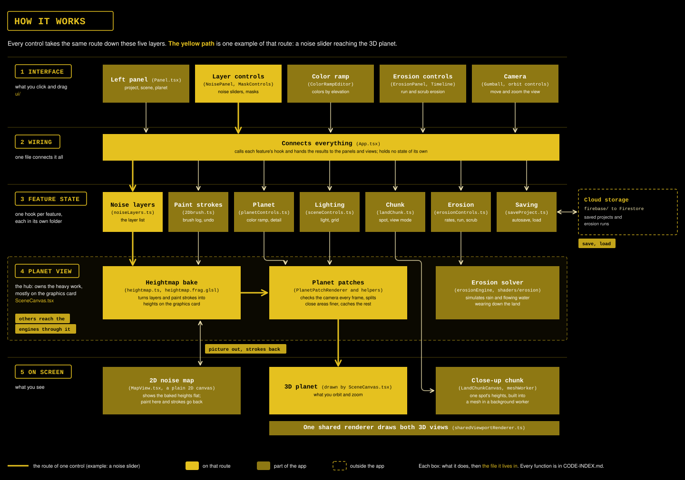

# Procedural World Building

`Last updated: 2026-10-23`

Cornell Tech, DESIGN 6197/4197, a procedural planet-building tool: paint and generate terrain on a sphere, built with Three.js + GLSL. This README is written for anyone with zero context on the project, what it is, and where everything lives. Kept up to date as the project changes, not a dated log.

This will eventually grow into the fuller README the course's final deliverable requires (conceptual premise, procedural systems/algorithms used, AI-assisted process, run instructions, credits), for now, at build stage, it covers what actually exists.


*Current state, 2026-10-21.*

**The other docs, all in `docs/`, and when to open them:**
> 🗺️ **[`ROADMAP.md`](docs/ROADMAP.md)**, current build status, organized by stage/feature. Start here to see what's done and what's next.
>
> 📐 **[`SPEC.md`](docs/SPEC.md)**, what the system is: architecture and the decisions that define it.
>
> 🐛 **[`ISSUES.md`](docs/ISSUES.md)**, what is broken, what was broken and why.
>
> 📅 **[`WEEKLY-PUSHES.md`](docs/WEEKLY-PUSHES.md)**, the syllabus's graded weekly report, chronological.
>
> 🧭 **[`CODE-INDEX.md`](docs/CODE-INDEX.md)**, where every part of the code lives, by file and function name.
>
> 📚 **[`REFERENCES.md`](docs/REFERENCES.md)**, every outside source the project relies on, grouped as conceptual, visual and computational.

---

## 🏛️ How it works

*Five layers, and every control travels down them in the same order.*

You move a control in the interface. `App.tsx` passes it to that feature's own hook, which holds the new value. The planet view then recomputes the terrain on the graphics card, and the views redraw. The yellow path traces one example, a noise slider, all the way to the 3D planet.



For every function and the chains between files, open [`CODE-INDEX.md`](docs/CODE-INDEX.md).

---

## 📦 Repo structure

*The README sits at the root; every other doc lives in `docs/`. The whole repo doubles as an Obsidian vault.*

```
.
├── README.md                 this file
├── docs/                     ROADMAP, SPEC, ISSUES, CODE-INDEX, REFERENCES, WEEKLY-PUSHES
│   ├── screenshots/          shots linked from the docs, named by date
│   └── diagrams/             the architecture diagram
├── .obsidian/                vault config; any .md in the repo is part of the vault
├── firebase.json, .firebaserc, firestore.rules   Firebase config and security rules
└── app/                      the Vite, React, TypeScript and Three.js project
    ├── public/               icons (the licensed fonts are not included)
    └── src/
        ├── App.tsx           composition root: wires each feature's hook into the layout
        ├── design.css        design tokens and every component's styles
        ├── map/              layer model, the GPU heightmap bake, the 2D map and brush
        ├── planet/           planet patches, their lifecycle, and planet settings
        ├── scene/            planet view, shared renderer, camera, grid, gumball, lighting
        ├── voxel/            close-up chunk: meshing in a background worker, its own view
        ├── erosion/          GPU erosion solver and the scrub timeline
        ├── ui/               panels, design-system components, icons
        ├── shaders/          GLSL, loaded as text
        ├── firebase/         client, anonymous sign-in, reads and writes
        └── projectSettings/  saving, loading and naming projects
```

---

## 🧩 Code organization conventions

*How the app is split up, and the rules in force.*

Patterns come from Dana's own `active-geometry-project`, not the class repo's Entity/World OOP pattern, which was tried and abandoned early.

### 🗂️ File by feature, not by component

*One file per feature or concern. Not one per UI component, and not large multi-purpose files either.*

Related small pieces are grouped by the feature they serve, so one file can hold several related panel-building functions rather than each getting its own. This overrides the class's usual one-component-per-file convention.

| folder under `app/src/` | holds |
|---|---|
| `ui/` | React-rendered panels and the shared component set |
| `scene/` | the Three.js scene, camera, renderer, grid, and the gumball |
| `planet/` | the planet's geometry and shader, terrain patches and their lifecycle |
| `map/` | the heightmap pipeline, the shared noise ranges table, and its 2D preview, including the brush |
| `voxel/` | the land chunk: its two render styles and its own viewport |
| `erosion/` | the grid-based erosion solver, its state hook and the scrub timeline |
| `shaders/` | GLSL, loaded as text |
| `firebase/` | the client, anonymous auth, and reads and writes |
| `projectSettings/` | saving, loading and naming projects, built on `firebase/` |

Three placements are worth knowing, because they look wrong otherwise:

- **The gumball sits in `scene/`, not `ui/`.** It is an imperative class driven by the render loop rather than a React component, so it belongs with the Three.js code it is coupled to.
- **`map/` is not nested under `planet/`**, even though it paints the planet's surface. It produces a texture the 3D scene consumes, which makes it its own subsystem rather than part of the planet.
- **`firebase/` is named for the technology, `projectSettings/` for the feature.** One talks to the service; the other is what is built on it.

### 🧵 `App.tsx` is a composition root

*It calls each feature's hook and wires the results into JSX. Nothing else.*

It never holds a feature's own state or handlers. When a feature gains state, it gets its own hook in its own folder at that moment, rather than accumulating in `App.tsx` and being split out later. See `[B11]` in `ISSUES.md` for the time that went wrong.

### 🎨 One CSS file

*`app/src/design.css` is the single source of truth, imported once.*

Tokens, layout and every component's rules live there. No per-component stylesheets. It expects licensed Helvetica files in `app/public/fonts/`, which are not in this repo for licensing reasons; without them the interface falls back to a system sans-serif.

### 🧮 Shaders

*Hand-written GLSL on real geometry, loaded as plain text.*

Shader source loads through Vite's `?raw` import rather than adding a GLSL plugin. Files with no `main()` are shared modules, concatenated ahead of whichever shader needs them, which is how the layer stack is reused.

### 📐 TypeScript

*`.tsx` everywhere, even without JSX, so nothing needs renaming later.*

> ❓ **Open:** the pure-logic files in `scene/` that will structurally never contain JSX are still `.ts`. Either rename them for consistency or keep the distinction deliberate.

### 🏷️ Placeholder values

*Anything arbitrary is flagged `// TODO(DS)` so it can be found later.*

Colors, lighting and distances with no design rationale yet are greppable and tracked for the tokenization pass in Stage 14.

---

## 📚 References and inspiration

*Every outside source, with what was taken from it, lives in `REFERENCES.md`.*

That covers the noise implementations used directly in the code, the methods behind the planet's terrain, and the tools and papers that shaped the pipeline's structure. Kept in one file so a source is cited once rather than repeated across docs.
