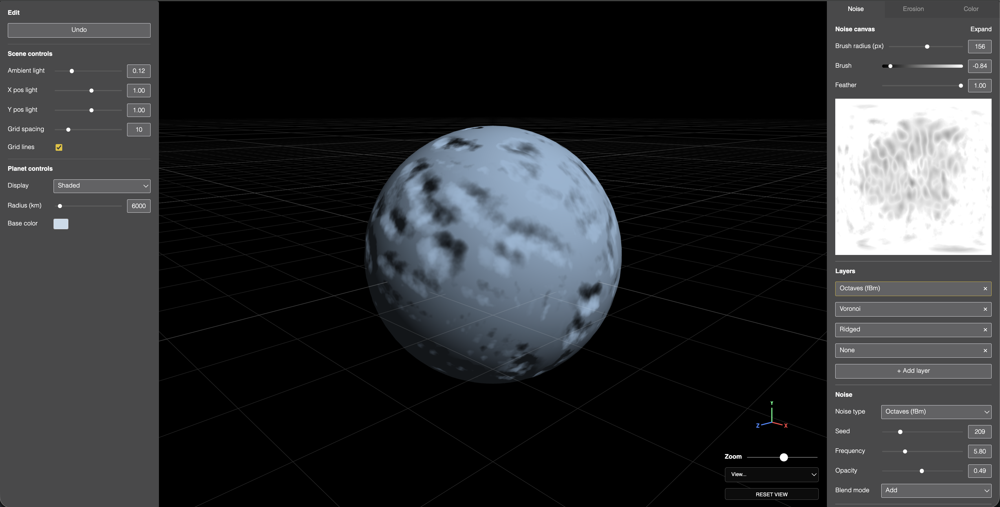
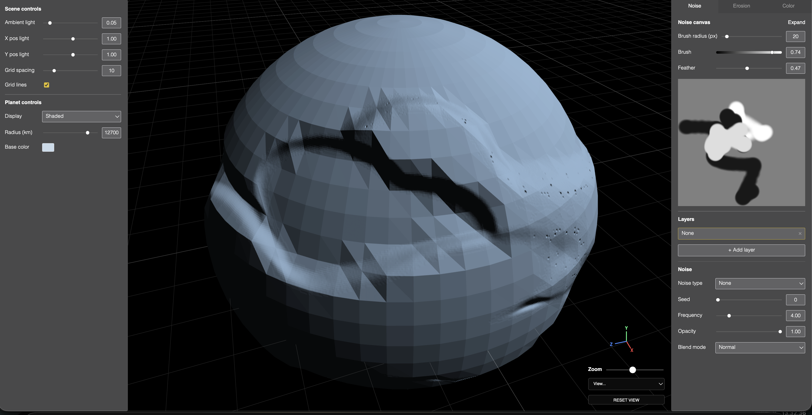

# 📅 Weekly Pushes

`Last updated: 2026-10-19`

*The syllabus's graded weekly report: what was attempted, how AI tools were used, what worked and what comes next. Newest first.*

---

## Week 07 · 2026-10-19

*Unified the planet and chunk under one renderer, and chased the chunk's color and shadow bugs down to their real causes.*

### 🛠️ Done
- One shared `WebGLRenderer`/canvas for both viewports (planet and chunk), replacing two independent ones, the base that lets a baked patch texture hand off straight to the GPU with no CPU readback.
- Both the planet and the chunk now render as terrain patches (a quadtree, each with its own baked heightmap) instead of one mesh sampling a shared map. Planet side is built but gated behind a flag, pending one known render/freeze regression.
- Land chunk: the material is built once and reused instead of rebuilt on every Resolution change (fixed a flash-to-flat flicker while dragging), resolution changes are debounced, and the texture ceiling was raised to the real WebGL2 floor (2048).
- Land chunk shading: the top surface and the cut walls/bottom cap now get two separate, non-bleeding elevation sources for color, lighting, and shadow, via a new per-triangle flag, fixing a hard seam that only showed up at certain light angles.
- Widened the normal-reconstruction gradient step, removing harsh, faceted-looking lighting on dense terrain.
- The elevation color ramp now reads the planet's own global range rather than computing one per patch, a whole-dataset color stretch, the standard GIS convention for this.
- Hydraulic erosion simulation (grid-based, GPU), with checkpointing and a scrub timeline.
- Real SVG icons replacing emoji button glyphs.

### 🤖 AI process
- Traced a wall-coloring "bleed" to its exact mechanism twice over: first an interpolating vertex attribute used as a material switch, then the same mistake found again in a second code block (normals, shadows) missed the first time.
- Corrected twice: once for treating a real, undecided design tradeoff as already settled, once for floating a dev-tooling explanation (stale hot-reload) ahead of the actual code-level bug.
- Checked a claim about dev-tooling behavior (Vite's hot reload, React's Fast Refresh) against real documentation before relying on it, then dropped it once a concrete, provable code cause was found instead.

### 📊 Worked / didn't / next
- ✅ Tracing a visual bug to the exact line and explaining the mechanism, instead of proposing a fix from a plausible-sounding theory.
- ❌ Two earlier wall-color fixes each solved the stated complaint but reintroduced a seam somewhere else. The durable fix needed a true non-interpolated flag, not a branch on an attribute already doing another job.
- ⏭️ Re-enable the planet's own per-patch rendering (fix its black-render regression), build the gradient color-ramp picker, then research soft shadows for the land chunk.

---

## Week 06 · 2026-10-13

*Rebuilt the planet on a cube sphere, and made the chunk a real piece of it.*

### 🛠️ Done
- Replaced the planet's longitude/latitude sphere with a cube sphere. A lat/long grid converges at two fixed points and cannot be subdivided locally, so it cannot support detail that follows the camera.
- Fixed the two seam bugs that switch exposed: a black slit, from lighting rebuilding its surface direction out of map coordinates, and terrain tearing at both poles, where the map's wrap line crosses the pole faces.
- Introduced the patch: one piece of the planet's surface with its own heightmap. Everything showing terrain now consumes patches.
- Rebuilt the land chunk as a patch drawn flat. Its Resolution reaches real detail instead of enlarging a window of a shared map, and double-clicking the planet picks which piece it shows.
- Moved the chunk onto the planet's lighting model, so the Scene controls mean the same thing in both views.
- Restructured the docs: split `SPEC.md` out of `ISSUES.md`, added `REFERENCES.md`, and cut both main docs by roughly two thirds.

### 🤖 AI process
- A wrong diagnosis cost most of the session. The claim was that reading height from the rectangular map is lossy at the poles; it is the reverse. A pipeline rebuild was built on it and reverted.
- What eventually found the real cause was rendering the data to screen rather than reasoning about it. Colouring the six faces ruled out a broken mesh; drawing height as greyscale showed exactly where it jumped.
- Two failures worth recording: a GPU texture-limit warning sat unread in the dev log throughout, and "the shader compiled" was treated as proof an approach worked when the failure was at bind time.

### 📊 Worked / didn't / next
- ✅ Building a diagnostic view instead of arguing further. Each one ruled out a whole class of cause in one screenshot.
- ✅ Checking conventions before committing to an architecture. Cesium's tile model and Outerra's per-patch heightmaps shaped the patch directly.
- ❌ Reasoning from first principles. It produced a confident wrong diagnosis and several fixes aimed at the wrong layer.
- ❌ Proposing small fixes already known to need replacing. Corrected toward building the durable unit once.
- ⏭️ Erosion as a reusable engine, plus the Timeline. Research points to grid-based rather than the droplet approach logged in September, since droplets need scattered writes that WebGL handles badly.

---

## Week 05 · 2026-10-07

*Answered the procedural-system feedback with a pipeline, not a UI tweak.*

### 🛠️ Done
- Responded to class feedback that the project reads as 3D terrain software rather than a procedural system, by researching real tools rather than reacting with a UI tweak.
- Decided the pipeline and its stages: Terrain, Erosion, Climate, Biome, Color, Population, Events. Colour became its own shader-driven stage; Population and Events are new.
- Decided Erosion is built as one reusable engine, so disasters become parameter values rather than separate effects.
- Decided the chunk moves onto the planet's shader, so shadows get implemented once for both rather than per view.
- Planned the left panel as the pipeline menu, with the right panel showing the selected stage.

### 🤖 AI process
- Cited real sources for every naming and ordering decision rather than asserting a preference.
- Corrected twice on pushback: proposed the easier shadow path, and misplaced general settings inside a stage.
- Flagged one citation as unverified rather than presenting it as sourced.

### 📊 Worked / didn't / next
- ✅ Searching conventions before deciding. It overturned one instinct and confirmed another.
- ⚠️ Defaulted to the lower-effort path twice, corrected directly rather than caught by testing.
- ⏭️ Build the pipeline menu; unify the chunk's shading; begin erosion.

---

## Week 04 · 2026-09-30

*Separated height from opacity, and made the modifiers composable.*

### 🛠️ Done
- Split terrain Height from the opacity composite into its own additive elevation channel, after the first pass turned out mathematically indistinguishable from Opacity.
- Fixed Ridged noise not being zero-mean, which inflated the whole planet once Height went unclamped.
- Made Height a percentage of its context, so one value reads proportionally on both the planet and the chunk.
- Made both panels user-resizable, and fixed the 2D canvas being a fixed-size square.
- Restructured noise modifiers from mutually exclusive types into composable toggles on any base generator, matching Gaea's structure.
- Received the class feedback on procedurality, and began a structured response rather than a cosmetic pass.

### 🤖 AI process
- Implemented before an explicit go-ahead again, caught and logged.
- Worked out the Height/Opacity collapse mathematically before proposing a fix rather than patching the symptom.
- Misdiagnosed a UI complaint once, then asked a precise question instead of guessing again.

### 📊 Worked / didn't / next
- ✅ Doing the elevation maths explicitly. The first instinct looked reasonable until tested.
- ⚠️ Three things needed a second full pass: the Height split, the panel width, and the Modifiers UI.
- ⏭️ Work through the procedural-system feedback properly.

---

## Week 03 · 2026-09-24

*Found the real resolution ceiling and rearchitected around it.*

### 🛠️ Done
- Rearchitected voxel meshing from a 3D grid to a column-based one, which was the real ceiling blocking the Resolution slider, and raised its maximum from 64 to 2048 as a result.
- Replaced four hand-derived wall cases with one boundary rule.
- Added layer multi-select with batch edit, visible drag-to-reorder, and a per-layer visibility toggle that genuinely skips a hidden layer's computation.

### 🤖 AI process
- Verified the new meshing's winding by hand via cross product rather than guessing.
- Added explicit checks for the new visibility field so older saved layers default to visible.

### 📊 Worked / didn't / next
- ✅ Tracing the Resolution ceiling to its real cause rather than raising the slider's maximum again, which had been tried first.
- ⏭️ Per-layer Height, contextual Resolution, shadows for the chunk.

---

## Week 03 · 2026-09-23

*Built the land chunk and the side-by-side view.*

### 🛠️ Done
- Added Redo, and reworked project naming so a project is never in an unnamed state.
- Built Stage 07: a side-by-side planet and chunk view with a resizable split and a mode control.
- Two render styles for the chunk from the same data: blocky voxel meshing in a Worker, and a smooth displaced surface extruded into a grounded slab.
- One shared gumball driving one or two cameras, each with its own reference distance.
- Fixed panes being destroyed on every view-mode switch, which reset the camera and the planet's colour.

### 🤖 AI process
- Corrected twice for implementing before a go-ahead, logged both times.
- Hand-verified the mesh winding rather than copying it, since it is derivable rather than a citable algorithm.

### 📊 Worked / didn't / next
- ✅ Designing the gumball around a list of targets from the start, once two instances was clearly wrong.
- ⚠️ Its zoom maths assumed the planet's scale and needed a second pass for the much smaller chunk.
- ⏭️ The voxel resolution ceiling; layer multi-select.

---

## Week 02 · 2026-09-22

*Real persistence, and two compositing bugs that needed the maths.*

### 🛠️ Done
- Set up real persistence: Firebase Auth and Firestore, anonymous sign-in, deployed security rules, and the layer stack saving per user.
- Fixed a compositing bug where adding a layer appeared to erase painted terrain beneath it. Took two attempts.
- Fixed brush strokes cutting off at the seam instead of wrapping.
- Rewrote stroke rendering as a distance to the whole stroke path, replacing a per-dab approach that left a visible crease.
- Restructured `ROADMAP.md` and `ISSUES.md` to Dana's design direction.

### 🤖 AI process
- Slipped once more on confirm-before-acting, caught and logged.
- Walked Dana through the Firebase console and CLI steps only she could do.
- Diagnosed two rendering bugs from screenshots via the actual maths rather than guessing.

### 📊 Worked / didn't / next
- ✅ Screenshots and live testing surfaced two subtle maths bugs that reading the shader would not have.
- ⚠️ The layer-erasing fix took two real attempts; the first applied the same mask twice.
- ⏭️ Erosion; revisit the still-jagged painted terrain.

---

## Week 01 · 2026-09-16

*The layer stack, the brush, and lighting that finally showed relief.*

### 🛠️ Done
- Built the multi-layer noise system: a Photoshop-style stack up to 16 layers, each with its own type, parameters, opacity and blend mode.
- Built the paint brush on the 2D heightmap, with strength and feather, live on both the preview and the planet.
- Fixed the planet having no real per-pixel normal, so terrain bumps did not show in lighting at all.
- Fixed paint erase doing nothing, diluted partial-opacity strokes, a pole tear, a faceting regression, and a brush-radius unit bug.
- Iterated the feather model through four designs based on live testing.

### 🤖 AI process
- Slipped twice on confirm-before-acting, logged each time.
- Verified rather than assumed: GPU float-blending support, Gaea's blend-mode formulas, and the normal's winding by hand.

### 📊 Worked / didn't / next
- ✅ Testing live and iterating from what was on screen. Several bugs only made sense once rendered.
- ⚠️ The feather design took four attempts, because the intent needed pinning down before implementing rather than after.
- ⏭️ The stroke-opacity fix; rebuild Expand; restructure modifiers; erosion.

---

## Week 00 · 2026-09-09

*Scaffolded the project and the base scene.*

### 🛠️ Done
- Scaffolded the project with Vite, React, TypeScript and Three.js.
- Built the base scene, the planet with its own GLSL shader, the UI component set, the left control panel, and ported the gumball widget.
- Set up the documentation structure, each file with a distinct scope.

### 🤖 AI process
- Strict confirm-before-acting from the start.
- Ported real code and values from `active-geometry-project` rather than inventing conventions, and debugged a StrictMode leak, an off-centre view, and a `pointer-events` cascade.

### 📊 Worked / didn't / next
- ✅ Going back to the actual source rather than memory. Once real font files and exact values were used, the UI matched.
- ⚠️ Several first passes drifted from the source without being flagged, caught by side-by-side comparison rather than by memory.
- ⏭️ Colour-picker decision, terrain generation, design-system tokenization.
