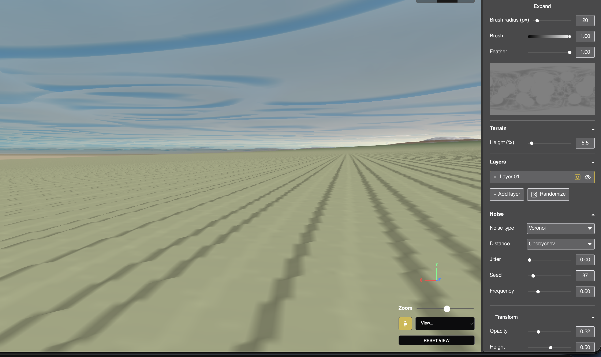
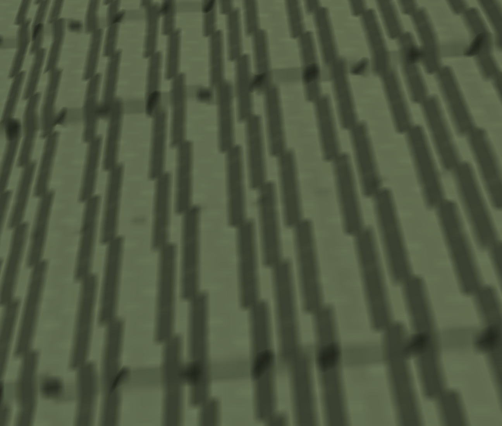

# 🐛 Issues

`Last updated: 2026-10-28`

*What is broken, what was broken and why, and problems tracked but not scheduled.*

> [!NOTE]
> 🔴 open · 🟡 partial or tabled · ✅ fixed · 📋 tracked, not scheduled
> Severity is a text tag: `blocks work` · `wrong but workable` · `minor`
>
> Bugs only. Architecture and the decisions behind it are in `SPEC.md`. Status by stage is in `ROADMAP.md`.

```
🔴 Open      12
🟡 Partial   22
❓ Decision   1
📋 Tracked    4
✅ Fixed     35
```

<details>
<summary>📋 <b>Format</b></summary>

```markdown
### [id] Short title · `severity`
**🔴 Open** · **Found:** YYYY-MM-DD · **Where:**

**What happens**
-

**Cause**
-
```

IDs are assigned in date order and never reused, so a reference stays valid once an entry moves between sections. Entries are grouped by topic, newest first within each group. When fixed, the status line gains the date and what it was.

</details>

---

## 🪐 Planet mesh

*The sphere itself, its seams, and the poles.*

### [B51] Zooming in doesn't reveal more terrain, unlike the land chunk · `wrong but workable`
**🔴 Open:** 2026-10-26 · **Found:** 2026-10-26 · **Where:** `scene/Gumball.tsx`, `shaders/heightmap.frag.glsl`

**What happened**
- Dana: up close the planet should look more and more like the land chunk, like zooming into Earth. It stays smooth color bands instead.

**Cause**
- The patch probe shows the mesh and texture now keep up (about 1 to 3 px per mesh cell, 1.5 px per texel), so the limit is no longer detail selection.
- At full zoom, a depth-7 patch about 73 km across fills about 120 px, so one pixel is about 600 m. The zoom stops far above the ground, at a scale far larger than the land chunk's.
- Extra octaves by depth only run on layers with the Octaves modifier on. A layer without it, like a lone Voronoi layer, is one frequency and gains nothing up close.

**Fix**
- Proposed, waiting on Dana.

### [B50] Resolution slider barely controls the planet, and detail loads in patches · `wrong but workable`
**🔴 Open:** 2026-10-25 · **Found:** 2026-10-25 · **Where:** `planet/planetPatches.ts`, `planet/patch.ts`

**What happened**
- Dana: the lowest Resolution setting still looks high, the planet loads high detail even from far away, and the detail "loads a bit patchy".

**Cause**
- When the triangle budget has room, which is mostly when zoomed out, an automatic bonus sharpens the threshold by up to six steps, toward 2 px. At the slider's coarsest end (32 px) that still lands near 8 px, the default.
- Few patches in view also bumps each patch's mesh up to 256 cells, and bake texture size targets 2 screen pixels per texel. Neither one follows the slider.
- The bonus steps in one per frame and each patch bakes small first, then upgrades. Both make detail arrive in visible waves.

**Fix**
- First attempt (2026-10-25) removed the bonus and the mesh tiers. Dana's test (2026-10-26): close-ups barely sharpen and stay stair-stepped, and the slider reads backwards. To be reverted, then the close-up measured before any new fix.
- Dana wants the slider shown as before, 128 to 2048 or more, higher is sharper: detail sharpens automatically by zoom, and the slider adds more or less on top.
- Reverted (2026-10-26). The slider shows Resolution 128 to 8192 again, higher is sharper, stored as pixels. A probe showed the close-up patch at depth 0 to 3 of 11 with 7 px mesh cells against a 0.5 px threshold: the triangle budget was blocking splits, because the 256-cell tier makes each patch 16 times as costly. The mesh is now fixed at 64 cells (Cesium's 65-sample tiles), untested.

### [B33] Planet near-froze when changing its Resolution · `wrong but workable`
**✅ Fixed:** 2026-10-18 · **Found:** 2026-10-18 · **Where:** `scene/SceneCanvas.tsx`

**What happened**
- Dragging the planet's own Resolution (mesh segments) control made the whole app go choppy, nearly freezing (Dana: "very choppy performance, nearly freezing"), not just a minor slowdown.

**Cause**
- The `[radius, meshSegments]` effect ran on every single change with no debouncing, rebuilding the planet's entire sphere geometry *and* a full `WireframeGeometry` overlay every time, the second one unconditionally, even when wireframe display mode wasn't active and nothing was showing it. A dragged slider fires many rapid changes, each one triggering this same expensive double rebuild back to back.
- This is the old single-mesh planet path specifically (`USE_PLANET_PATCHES` is currently `false`, the fallback from `[B?]`'s earlier black-planet regression), not the new patch system, which already picks up a radius change lazily, throttled, on its own.

**Fix**
- Debounced (150ms, same `setTimeout`/`clearTimeout` pattern `projectSettings/saveProject.ts` already uses for its own autosave): the geometry rebuild only runs once the value settles, not on every intermediate tick while dragging.
- The wireframe overlay only rebuilds when wireframe mode is actually selected; otherwise it's marked stale (`wireframeStaleRef`) and rebuilt lazily the moment wireframe mode is next chosen, in the existing `[displayMode]` effect, rather than paying that cost on every resolution change regardless of whether it's ever shown.

### [B26] Soft blur and rough ridging at both poles · `minor`
**🟡 Likely resolved by [B28]'s patch rendering, not yet visually confirmed** · **Found:** 2026-10-13 · **Where:** the heightmap's own format

**What happens**
- Improved but not solved. The hairline and the tearing are gone; a soft blur and some rough ridging remain at both poles.

**Cause**
- Every longitude converges to one point at each pole, so data stored in a rectangular map bunches up there. Visible directly in the 2D preview, whose top and bottom edges smear the same way.
- Not fixable while the map is where detail lives. Goes with [B28].
- More precisely: the noise itself is correct at every point, `heightmap.frag.glsl`'s `uvToSpherePosition()` samples the true 3D position, not the distorted flat map. The actual cause is in `fragment.glsl`'s per-pixel bump mapping.
  - The analytic tangent `dPdu` correctly shrinks toward zero at the poles via its `cosLat` factor, but the finite-difference height gradient `dHdu` divides by a fixed UV-space `sampleOffset` (32/1024) with no equivalent tapering. Near a pole, that fixed UV offset spans an almost vanishing physical distance, so the gradient term comes to dominate the tangent exactly where the real tangent collapses toward zero.
  - Blur and ridging are the same ill-conditioned normal basis read two ways, blur where neighboring texels' noise happens to land close, ridging where it diverges, both equally likely since nothing tapers the base noise amplitude near a pole on this path.

### [B24] Terrain tore into streaks at both poles · `blocks work`
**✅ Fixed:** 2026-10-13 · **Found:** 2026-10-13 · **Where:** `planet/mesh.ts`

**What happened**
- Terrain tore into thin stretched streaks at both poles once height was turned up. A separate symptom, a black slit across the surface, appeared at the same time.

**Cause**
- The map wraps at longitude 180°, and that line crosses both pole faces, so triangles sitting on it read from both ends of the map at once and smeared the whole map width across themselves.
- The black slit had a different cause: lighting rebuilt its surface direction from map coordinates, which jump at the wrap line.

**Fix**
- Each pole face is generated as two halves split along that line, so no triangle spans it. The same approach `SphereGeometry` uses at its own seam, which is why the old sphere never showed this.
- Lighting now works from each point's 3D position rather than from map coordinates.

### [B25] ⚠️ A wrong diagnosis, and what it cost · `blocks work`
**✅ Reverted:** 2026-10-13 · **Found:** 2026-10-13 · **Kept deliberately**

**The claim**
- That reading height out of the rectangular map is lossy at the poles. It is the reverse: an equirectangular map over-samples near the poles, so no detail was being lost.

**What was built on it**
- The layer stack was split into a shared module so the planet could evaluate terrain from 3D position. That meant the vertex shader sampling sixteen paint textures, which exhausted the GPU's texture slots, so no height reached the planet and it rendered perfectly smooth. All reverted.

**How it went unnoticed**
- The texture limit was a warning in the dev server log the whole time and was not read.
- "The shader compiled" was treated as proof the approach worked, when the failure was at bind time.
- Several rounds went into reasoning about what should happen rather than looking at the rendered data. What found it was drawing the height value on screen as color.

---

## 🎨 Painting & brush

*Authoring by hand, and what the strokes produce.*

### [B27] Expand shows a black preview · `wrong but workable`
**🔴 Open** · **Found:** 2026-10-13 · **Where:** the noise canvas's Expand view

**What happens**
- Expand renders black instead of the heightmap.

**Cause**
- Not diagnosed. Not established whether it predates the cube-sphere work or arrived with it. The 2D canvas reads the heightmap pipeline rather than the planet mesh, so a connection is not obvious either way.

### [B14] Terrain still jagged, feather still subtle · `minor`
**🟡 Tabled** by Dana until after erosion · **Found:** 2026-09-22

**What happens**
- Painted features displace with jagged edges, and the feather is hard to see.

**Cause**
- Likely the sphere's mesh resolution being too coarse for a narrow painted feature, since displacement only happens at vertices.

### [B13] Stroke drag hardened soft edges · `wrong but workable`
**✅ Fixed:** 2026-09-22, after one wrong fix · **Found:** 2026-09-16

**Cause**
- Compositing each dab over the last saturated a soft edge into a hard one within a single drag.
- A max-accumulation buffer fixed the hardening but left a crease in the falloff wherever two dabs were equidistant, invisible in flat color but visible once it drove displacement.

**Fix**
- Distance is computed to the whole stroke path at once, one smooth shape with no crease, which also removed a separate buffer and pass.

### [B12] Brush strokes cut off at the seam · `wrong but workable`
**✅ Fixed:** 2026-09-22 · **Found:** 2026-09-22

**Cause**
- Falloff used a plain distance in map coordinates, which does not know the left and right edges are the same place.

**Fix**
- Wrapping the horizontal component. Does not retroactively repair strokes painted before the fix.

### [B15] Replayed strokes and undo didn't update until clicked · `wrong but workable`
**✅ Fixed:** 2026-09-22 · **Found:** 2026-09-22 · **Two different causes**

**Cause**
- **On reload:** a real ordering bug. React runs a child's effects before its parent's, so the views read the texture before the parent had replayed into it.
- **On undo:** not ordering but a missing connection. The 2D canvas only watched layers, and undo only changes history, so no ordering fix could help.

**Fix**
- Reload: reordered so replay happens before state is set, and the earlier workaround was deleted rather than left alongside.
- Undo: a small counter threaded down as a prop, the legitimate use of a signal here.
- Worth distinguishing: fix the order when it is an ordering bug, add a signal only when there is genuinely no connection.

### [B07] Painting toward black did nothing · `blocks work`
**✅ Fixed:** 2026-09-16 · **Found:** 2026-09-16

**Cause**
- WebGL clamps shader output before blending, which silently zeroed a negative erase value, and blending into a float target needs an extension that is not reliably supported.

**Fix**
- Ping-pong targets instead of GPU blending, so each stroke computes the complete new frame in the shader.

### [B08] Partial-opacity strokes looked dark · `minor`
**✅ Fixed:** 2026-09-16 · Value and mask were blended at the same rate rather than by Porter-Duff "over".

### [B09] Brush radius used the canvas's display size · `minor`
**✅ Fixed:** 2026-09-16 · Converted against the texture's fixed resolution instead.

---

## 🧱 Layers & noise

*Generating terrain and composing it.*

### [B18] Ridged noise inflated the whole planet rather than its peaks · `wrong but workable`
**✅ Fixed:** 2026-09-24 · **Found:** 2026-09-24

**Cause**
- `ridge(x) = 1 - abs(x)` peaks where its input is most common, so its output sat near maximum almost everywhere. Every other noise type here is symmetric around zero; Ridged alone carried a strong positive bias.
- Invisible while the old pipeline clamped everything, but once Height applied the raw value as unclamped additive elevation, the bias scaled with it.

**Fix**
- Re-centered `ridge` itself rather than special-casing one noise type downstream.

### [B10] A new layer visually erased painted terrain beneath it · `blocks work`
**✅ Fixed:** 2026-09-22, after 2 wrong attempts · **Found:** 2026-09-22

**Cause**
- An empty layer's flat gray placeholder read as real opaque content at full opacity, replacing everything under it. No data was lost; purely a compositing bug.

**Fix**
- The paint mask is applied exactly once as coverage, with the composite starting at neutral gray rather than black. Starting at black had made painted black indistinguishable from nothing painted.

### [B17] Old saved layers defaulted to hidden · `wrong but workable`
**✅ Fixed:** 2026-09-23 · A missing field read as falsy rather than as visible.

---

## 🧊 Land chunk

*The flattened detail view and its two render styles.*

### [B32] Resolution slider goes past what the chunk can actually use · `minor`
**✅ Fixed:** 2026-10-17 · **Found:** 2026-10-14 · **Where:** `scene/sharedViewportRenderer.ts` (new), `scene/SceneCanvas.tsx`, `voxel/LandChunkCanvas.tsx`, `App.tsx`, `planet/patch.ts`, `voxel/landChunk.ts`, `shaders/chunk.vert.glsl`, `shaders/chunk.frag.glsl`, `shaders/terrain.glsl`

**What happened**
- The land chunk's Resolution slider went up to 2048, but values past roughly 513 changed nothing in either render style, capped by `MAX_PATCH_SAMPLES`'s GPU-readback cost guardrail in `planet/patch.ts`.

**First attempt, and the regression it caused**
- The smooth style's heightmap was made to stay entirely GPU-side, baked on the *planet's* own `WebGLRenderer` and handed directly to the land chunk's material. This rendered as a completely flat, black, undisplaced chunk (Dana, 2026-10-17: "the chunk isnt showing the planet"). Root cause: the land chunk rendered through its *own*, separate `WebGLRenderer` on its own canvas, and a `WebGLRenderTarget`'s texture is a GPU resource owned by whichever renderer/context created it, it cannot be bound and sampled directly by a different one.
- Reverted to a CPU readback to stop the regression (now superseded by the fix below), which also meant giving up the higher resolution ceiling the first attempt claimed, since avoiding the readback entirely requires the two renderers to actually be one.

**Real fix: one shared renderer for both panes**
- New `scene/sharedViewportRenderer.ts`: one `THREE.WebGLRenderer` on one shared `<canvas>`, each pane drawn into its own rectangle via `setViewport`/`setScissor` every frame, the documented Three.js technique for multiple simultaneous views (`examples/webgl_multiple_elements.html`). `SceneCanvas.tsx`/`LandChunkCanvas.tsx` no longer create their own canvas, renderer, resize observer, or animation loop, each registers its scene/camera/per-frame callback and renders into its own `.planet-viewport`/`.land-chunk-viewport` div (now also each pane's own element for click-picking and its OrbitControls' DOM target, replacing the canvas both used to be).
- With both panes genuinely on one renderer, the GPU-only hand-off is valid again: `getPatchRegionTexture` (not `getPatchRegionElevation`) bakes a patch's heightmap once and hands the texture straight to the chunk's material, no CPU round trip, `MAX_PATCH_TEXTURE_RESOLUTION`/`clampPatchTextureResolution` (1024, GPU-only) back in `planet/patch.ts`, distinct from `MAX_PATCH_SAMPLES` (513), which still governs whatever *does* get read back (the color ramp's min/max, voxel's own CPU mesh data, untouched by this).
- Smooth mode's texture is the planet's own multi-channel bake format (elevation in green); voxel's is still a plain single-channel CPU texture (red). `chunk.vert.glsl`/`chunk.frag.glsl`/`terrain.glsl`'s `heightmapShadow` all take a `uHeightMapGreenChannel` uniform (set per render style in `App.tsx`) to read the right one, rather than assuming either.
- Dana was explicit voxel mode is allowed to stay restricted regardless: its own mesh is genuinely built from CPU data (`density.ts`'s `buildChunkHeights`), not just shaded by it, a real constraint already tracked as `[B05]`, untouched by any of this.

**The remaining stall: a min/max reduction pyramid, not a bigger readback**
- Dana separately reported the whole app stalling briefly on every Resolution change (2026-10-17: "the whole software seems to get stuck for a bit"), traced to the color ramp's min/max calculation running a full synchronous CPU readback (`getPatchElevationData`) on every change, purely to find two numbers.
- Fixed for smooth/shaded style: a min/max reduction pyramid (Tevs, Ihrke & Seidel 2008, "Maximum Mipmaps," see `REFERENCES.md`) halves the baked patch over and over in `map/heightmap.ts`'s new `getRegionMinMaxAsync()`, each pass keeping the true min/max of every 2x2 block rather than blurring it away, down to one texel holding the patch's exact min/max.
  - Only that one texel is ever read back, via the async PBO+fence method already built (`getRegionElevationDataAsync`, which had no caller until now).
  - Guarded against the request race Dana flagged ("the color needs to be live or it will get stuck"): `landChunk.ts`'s `minMaxRequestIdRef` tags each request, and a slower, older request resolving after a newer one is silently discarded rather than overwriting the ramp.
- When an erosion run already has the elevation data in memory, that's used directly (free, no new readback of any kind), the reduction pyramid only runs for a fresh bake.
- Voxel style is unchanged and still pays the full synchronous readback, its own mesh is genuinely built from that CPU array, not just shaded by it, the same accepted `[B05]` constraint as the display-path fix above.
- **That open question was real: confirmed, then fixed.** The literal min/max above let one outlier pixel (this terrain's own spiky noise reliably produces one) set the ramp's range far wider than the terrain's real bulk variation, squeezing everything else into a narrow slice of it, Dana, 2026-10-18, saw this directly as repeating color bands following the terrain's contours, not a gradient, confirmed not the Terrace modifier.
  - Fixed with a GPU-built histogram (same technique real-time HDR auto-exposure uses so one bright pixel can't blow out a whole frame's exposure, see `REFERENCES.md`, "GPU histogram"): `map/heightmap.ts`'s new `getRegionPercentileRangeAsync()` scatters a fixed 256x256 grid of sample points (`shaders/elevationHistogram.vert.glsl`/`.frag.glsl`) into a 256-bin, 1px-tall target via additive blending, bucketed against the reduction pyramid's own literal extremes, then reads back just those 256 values and walks them to the 1st/99th percentile with the exact same logic `map/elevationRange.ts`'s CPU version already used (`HISTOGRAM_BINS`/`CLIP_PERCENT` now exported from there and shared, not duplicated).
  - Wired into `landChunk.ts`'s smooth-style branch in place of the literal min/max call, same request-id race guard as before. Voxel style is untouched, still correct, still uses the CPU histogram directly.

**The real fix was one level up: a shared range, not a better local one**
- Dana caught the actual inconsistency, 2026-10-18: "the chunk should be a part of the planet... it should use the planet's values."
  - Computing any range fresh per patch, however correctly, means the same real elevation can read as a different color depending on which patch you're looking at, and duplicates work the planet already does.
  - The GIS convention for this (QGIS's `WholeRaster` raster-symbology option, see `REFERENCES.md`, "Whole-dataset vs. current-view color stretch") is a stretch computed once per dataset, applied everywhere, not recomputed per tile, exactly this project's own earlier decision that the ramp "should encompass all terrain levels that exist in the planet," which the chunk's own percent-clip work had drifted away from.
- `SceneCanvas.tsx` gains `getElevationRange()`, returning the planet's own global range, already computed once whenever its heightmap changes and already kept live for every planet patch (`sharedUniformsRef`), nothing new to compute. `landChunk.ts`'s smooth and voxel branches both now read this instead of computing their own, voxel's CPU elevation data stays exactly as needed for its own mesh, only the ramp's range source changed. `minMaxRequestIdRef` and its race-guard, and the `computeElevationRange` import, are now dead and removed, nothing in this file computes a range anymore, it only reads one.
- The GPU histogram pass above is no longer called by the chunk, but stays in the codebase: it's still the right mechanism for a real, separate follow-up (making the planet's own `updateElevationRange()` cheaper, which still does a full CPU readback today), not required for this fix, not yet approved to build.
- Expected, not a bug: a small, flat-looking close-up patch may now show mostly one color if the planet's full range is much wider than what's visible in that one patch, that's the correct behavior for a whole-dataset stretch.

**The wall/cut face: layers, then a flat color by design**
- The chunk's vertical skirt walls showed repeating horizontal "layers" (Dana: "why does the chunk have layers"). Cause: the wall's bottom edge carried a placeholder uv of `(0,0)` while its top edge carried the real terrain uv, interpolated between the two down the wall's height, so the sampled point slid diagonally across the whole heightmap as you went down, reading unrelated elevation values and cycling the ramp into stripes. Fixed in `voxel/smoothMesh.ts`: the bottom edge now carries its own column's real uv too (not the placeholder), locking sampling to one real column the whole way down, no drift.
- Dana then decided the wall shouldn't read the elevation ramp at all: "the color of the cut area should be one color of that height, which is likely the low elevation color." A cut face has no single elevation of its own to color by. Fixed in `shaders/chunk.frag.glsl`: the ramp calculation is now gated to `vDisplace > 0.5` (the real top surface only), walls/the bottom cap keep `surfaceColor`'s own default, `uBaseColor`, untouched by the ramp entirely.
- Dana then reversed that too: "and if the ground is cut in the middle of a mountain?? is it still low elevation colors?" A flat base color for every wall regardless of what it's under was wrong.
  - Fixed, first attempt: the ramp was extended to walls using a new `wallElevationRaw`, recovered from the fragment's own world-space height, picked via `vDisplace > 0.5 ? elevationRaw : wallElevationRaw`. Since `vDisplace` is a per-vertex attribute that interpolates smoothly across a wall fragment, this ternary switched height sources mid-wall, at the exact line where interpolated `vDisplace` crosses 0.5, a hard color seam across every wall (Dana, 2026-10-19, screenshot: "there's a clear color border between the land chunk inside and outside color... a harsh border that shouldn't exist").
  - **Real fix:** `wallElevationRaw` and the ternary were unnecessary, removed entirely. `elevationRaw` (the plain texture sample at `vUv`) already gives each wall fragment its own column's real terrain height, constant down the whole wall, because the uv-placeholder fix two steps above already made a wall's top and bottom vertices share one real uv, exactly the per-column coloring Dana wanted, with no second height source and no seam.
- **Reopened, 2026-10-19:** the "expected, not a bug" line below was Dana's own earlier decision described after the fact, not something she'd signed off on seeing in practice, her retest showed real flattening and she rejected it ("it might be a tradeoff to you, i never agreed to this"). Still open: whether to revert to a per-patch range (the percent-clip histogram work below, already built, currently unused), add a separate local-contrast-stretch display layer on top of the global range (a different, real GIS convention from `WholeRaster`, to be researched before proposing specifics), or something else. Dana's call.

**The wall ramp, take two: top and sides as two separate materials, not one shared value**
- Dana's actual ask, restated in her own words: "cutting a slice of cake, the sides show the inside only, the top is the frosting and it does not bleed into the sides." The top surface keeps the real elevation ramp (`elevationRaw`, full detail, unchanged). The walls/bottom cap get their own plain, direct world-height-to-color mapping, no blending with the top's value at the boundary, no "subtle"/strata treatment, just the same `terrainRampColor` fed a different height source.
- New `isTopSurface` attribute (`voxel/smoothMesh.ts`, threaded through `shaders/chunk.vert.glsl`/`chunk.frag.glsl` as `vIsTopSurface`), 1 for every vertex of a top-surface triangle, 0 for every vertex of a wall/cap triangle, always uniform within one triangle, unlike `displace` (which must stay mixed within a wall quad for vertex positioning).
  - Confirmed against real GLSL documentation first (Khronos forum threads on `flat`/provoking-vertex): a per-triangle-constant attribute shows up with no interpolation artifact, because interpolating a constant returns the same constant, this project's chunk mesh already builds the top surface and the walls as separate, non-shared triangles, so this applies directly.
- `chunk.frag.glsl` now branches the ramp's elevation source on `vIsTopSurface` (not `vDisplace`, which is what caused the earlier mid-wall seam): top surface uses `elevationRaw`; walls/cap use a plain `(vWorldPosition.y / uMaxHeight) - 0.5`. The branch is safe this time because `vIsTopSurface` never takes an intermediate value within a triangle, so every fragment in a given triangle agrees on which side of the branch it's on.
- Voxel mode's own separate mesh (`voxel/meshWorker.ts`) also had to gain this attribute (shared shader), set uniformly to 1 for every face, voxel's own elevation-ramp coloring is already a known, accepted placeholder limitation (its `uv` is always `(0,0)`, unrelated to this fix), so this keeps its current behavior unchanged rather than silently improving or regressing it as a side effect.
- **Same bleed, a different block:** Dana still saw a divide "from certain angles" after the above (2026-10-19). The normal-reconstruction block and the shadow block in `chunk.frag.glsl` were still gated on `vDisplace > 0.5`, not switched over to `vIsTopSurface` with the ramp.
  - Since `vDisplace` still interpolates smoothly across a wall quad (it has to, for vertex positioning), the upper half of every wall was still getting the top surface's heightmap-gradient normal formula wrongly applied to it, switching to the wall's own correct flat normal only below the crossover point, invisible at light angles where the two normals happen to produce similar brightness, a sharp seam at others. Fixed: both blocks now key off `vIsTopSurface` too, same as the ramp.
  - `vDisplace` itself is untouched, still needed for vertex positioning in `chunk.vert.glsl`.

**The slider's own max still didn't match the real ceiling**
- Diagnosed while chasing a separate flattening report: the Resolution slider's max was still 2048, while `MAX_PATCH_TEXTURE_RESOLUTION` (the real GPU-texture ceiling restored above) is 1024, the same honest-UI mismatch this issue originally started as, recurring in the newer cap. Fixed in `ui/Panel.tsx`: max lowered to 1024.

**The last piece: a flash to flat while actually dragging the slider**
- Dana confirmed this wasn't flatness above some resolution, it was a brief flicker to flat on every single tick while dragging, in both render styles, masked above 1024 only because the clamp above meant nothing new was actually triggered up there, not because the flicker stopped happening. Two WebGL extension theories (float-texture linear filtering, rendering to a float target) were checked directly in Dana's own browser console and ruled out with certainty, neither was missing.
- Live instrumentation (temporary `console.log`s, since removed) confirmed the real cycle: a dragged slider fires a full rebake, geometry rebuild, and mesh/material rebuild on every intermediate value, dozens of times a second, exactly the pattern already fixed once tonight for the planet's own resolution control, just never extended to the land chunk's own effect.
- Fixed in `voxel/landChunk.ts`: the same 150ms debounce already used for the planet (`scene/SceneCanvas.tsx`), scoped specifically to `resolution` via a new `debouncedResolution` value, not the whole effect, a new patch, a layer edit, a finished erosion run, or a render-style switch all still run immediately through the effect's other dependencies, only continuous slider-dragging is delayed.
- **Closed:** `voxel/LandChunkCanvas.tsx` was still rebuilding a brand new `ShaderMaterial` on every geometry change instead of reusing one and updating its uniforms, the documented Three.js anti-pattern this same investigation surfaced, on top of (not replaced by) the debounce above. Fixed: the material and mesh are now built once and kept for the component's whole lifetime; a later geometry change only swaps `mesh.geometry`, never rebuilds the material, so no shader recompile happens past the first time.

### [B23] The chunk's surface speckled with flickering dark patches · `wrong but workable`
**✅ Fixed:** 2026-10-13 · **Found:** 2026-10-13 · **Where:** `voxel/smoothMesh.ts`

**Cause**
- Terrain height clamps at zero and the slab's base cap also sat at zero, so every flat-bottomed area put the top surface and the base at identical depth. The GPU cannot order two coincident surfaces.

**Fix**
- The base sits below zero, giving the slab real thickness.

### [B16] Smooth-mesh walls were missing on some sides · `wrong but workable`
**✅ Fixed:** 2026-09-23 · **Found:** 2026-09-23

**Cause**
- Four walls each had their winding derived independently, so there were four chances to get the sign wrong, and a wrong winding makes a face invisible.

**Fix**
- One boundary walk using a single formula, verified once rather than four times.

### [B19] Switching view mode reset the planet's color and camera · `wrong but workable`
**✅ Fixed:** 2026-09-23 · **Found:** 2026-09-23

**Cause**
- The view-mode control conditionally rendered each pane, so leaving a mode destroyed that pane's whole scene, camera and renderer. Returning built a new one, showing the shader's construction-time placeholder color.

**Fix**
- Both panes stay mounted and only their visibility toggles.

### [B20] Chunk sat half-buried under the grid · `minor`
**✅ Fixed:** 2026-09-23 · The mesh centered all three axes including the vertical one.

---

## 💡 Lighting

*How surfaces are shaded.*

### [B72] The planet flickered while dragging a light slider · `wrong but workable`
**✅ Fixed:** 2026-10-28 · **Found:** 2026-10-28 · **Where:** `scene/SceneCanvas.tsx`
- Dana: the planet view flickered while dragging Ambient light, Wrap, Light elevation or the Shine sliders; the chunk did not.
- Cause, measured: an ordering bug. Each slider rerun set the shared light to its raw direction, and the next frame's haze and clouds read it before it was turned to follow the camera, so for one frame they were lit 0.806 rad (46°) off. An A/B test with the old ambient ruled out the new colored fill.
- Fixed: each frame turns the light first, before anything reads it, and the sliders set only the raw base direction.

### [B06] Terrain bumps didn't show in lighting · `wrong but workable`
**✅ Fixed:** 2026-09-16 · **Found:** 2026-09-16

**Cause**
- A screen-space-derivative normal was tried first and faceted the whole sphere, since derivatives are near-constant per triangle. Dana liked the look enough to keep it as a possible future style option.

**Fix**
- The sphere's tangent basis is computed analytically, so the normal is smooth and independent of mesh resolution.
- Two follow-ups: tangents were unit-sphere-relative while displacement was world-scaled, and `normalMatrix` is auto-set by Three.js but not auto-declared in the fragment stage.

---

## 🌈 Terrain color

*The elevation color ramp, a placeholder for Stage 11's real height+climate+biome shader.*

### [B29] Color contrast still appears too suddenly · `minor`
**✅ No longer reproducing:** 2026-10-19 (Dana: "it doesnt, its fine") · **Found:** 2026-10-13 · **Where:** `shaders/fragment.glsl`, `shaders/chunk.frag.glsl`

**What happened**
- The ramp's Mid/High contrast fades in as Height (%) rises, rather than always filling the full range, but Dana reported it still appeared too sudden even after that fix. Re-checked 2026-10-19 (after the unrelated chunk-color/[B32] work above), no longer seen. Left as-is, not re-diagnosed further, since there's nothing left to chase.

### [B30] Steep terrain went near-black with Cast shadows off · `wrong but workable`
**✅ Fixed:** 2026-10-14 · **Found:** 2026-10-14 · **Where:** `shaders/fragment.glsl`, `shaders/chunk.frag.glsl`, `shaders/terrain.glsl`

**What happens**
- With Color by elevation on, steep slopes read near-black even with Cast shadows off, crushing the ramp's own colors toward black instead of showing them (Dana, 2026-10-14: "the only darkening should be from shadows").

**Cause**
- `slopeAmbientOcclusion` cut the ambient term to as low as 0.4x of normal on any steep face, but only while Color by elevation was on. This terrain is almost entirely steep spike flanks, so ambient collapsed nearly everywhere; combined with faces turned away from the light, brightness bottomed out near black. Not a real shadow, a slope-based approximation standing in for one.

**Fix**
- Removed the slope darkening entirely, from both shaders and its now-unused definition in `terrain.glsl`. Brightness now comes only from the real ambient floor, real diffuse lighting, and actual cast shadows (land chunk only, for now).

### [B31] Terrain reads as unrealistically spiky · `minor`
**✅ Fixed:** 2026-10-14 · **Found:** 2026-10-14 · **Where:** `shaders/heightmap.frag.glsl`

**Cause**
- `ridge()` (`shaders/noise.glsl`) folded the *final*, already-summed fBm value once, rather than folding each octave individually the way real ridged-multifractal noise does (Musgrave's method, see `REFERENCES.md`).
  - Folding a single high-frequency signal turns every zero-crossing into a sharp peak, which read as a few broad ridgelines at low frequency but as a dense field of small, isotropic spikes at high frequency.
  - `randomizeTerrain()` (`map/noiseLayers.ts`) can independently roll `frequency` up to 20 (5x the default of 4), `heightScale` up to 10 (10x the default of 1), and `ridgedEnabled` true, all at the same time, this combination was a likely result of one randomize press, not a rare edge case.

**Fix**
- Added `ridgedFbm3D()`, a real per-octave ridged accumulation: each octave's own sample is folded via `ridge()` before being summed, weighted by the previous octave's own folded magnitude as a feedback term, matching the cited algorithm's structure rather than approximating it. Reuses the existing `ridge()` and `ridgeAmount`, no new uniforms. Only replaces the path when both Octaves and Ridged are enabled together, a single ridged sample with no octaves had nothing per-octave to fix.

### [B34] Harsh, noisy-looking lighting on dense chunk terrain · `minor`
**✅ Fixed:** 2026-10-19 · **Found:** 2026-10-19 · **Where:** `shaders/chunk.frag.glsl`

**Cause**
- The top surface's per-fragment normal is rebuilt from the heightmap's own central-difference gradient (`chunk.frag.glsl`), reading 1 texel to either side. On this terrain's typically high-frequency, high-amplitude noise, a 1-texel step reads the noise's own grain as if it were the real slope, producing a sharp, metallic, "faceted" look under lighting rather than a smooth one.

**Fix**
- Widened the gradient step to 32 texels, matching `fragment.glsl`'s (the planet's) own already-validated `sampleOffset` for the identical problem, same reasoning carried over rather than re-derived.

### [B35] Land chunk shadows look harsh · `minor`
**✅ Fixed:** 2026-10-20 · **Found:** 2026-10-19 · **Where:** `shaders/terrain.glsl` (`heightmapShadow`)

**What happened**
- Dana, pointing back at her earlier screenshots: "the shadows are harsh... in the land chunk."

**Cause**
- `heightmapShadow` was a binary hit-test, a sample point either fully lit or fully shadowed (`return 0.0`/`return 1.0`), with no soft edge/penumbra at all. That's inherent to the simple raking self-shadow march this uses (real, cited technique, see `REFERENCES.md`), not a bug in how it's wired.

**Fix**
- Quilez's raymarched soft-shadow technique (see `REFERENCES.md`): the march now tracks the smallest ratio of (how far the ray sits above the sampled terrain, in world units) to (world distance traveled so far), `SHADOW_SOFTNESS` scaling how quickly a near-miss darkens, instead of returning a hard 0/1 the instant one sample occludes. Same march, same step count, no new samples. Adapted from the original SDF version (distance-to-nearest-surface) to this heightfield march's own ray-height-minus-sampled-height gap.

---

## 🖥️ UI & panels

*The controls and the viewport around them.*

### [B49] Tooltips are hard to read and can run off screen · `minor`
**🟡 Built 2026-10-21, untested** · **Found:** 2026-10-21 · **Where:** `design.css` (`.ui-tooltip`), every control with a tooltip

**What happens**
- Tooltips should be black, wrap their text, and stay on screen. Today they use the panel color and can run past the screen edge (Dana, screenshot).
- It is a design-system change, so it affects every tooltip.
- Built: black through a new design-system token (`--color-tooltip-bg`), text wraps at 240px, and the tooltip uses a fixed position clamped to the window.
- One shared placement function (`placeTooltip` in `ui/UIElements.tsx`) and one delegated listener cover every tooltip.

### [B64] The timeline panel is cut off on the right and can't be closed · `wrong but workable`
**🔴 Open** · **Found:** 2026-10-27 · **Where:** the timeline panel at the bottom (play, erosion, reset; years scale)

**What happens**
- Dana (screenshot, 2026-10-27): the panel runs past the right edge, cutting off the Unit select, the year field's buttons and the end of the scale. There's no X to dismiss it.
- Cause not checked yet. A close button would be a design-system button with every state and its own icon.

### [B63] Walk mode goes underwater and can't move from there · `wrong but workable`
**🟡 Built, partly tested 2026-10-27** · **Where:** `scene/walkMode.ts`, `voxel/chunkGround.ts`, `voxel/LandChunkCanvas.tsx`

**What happens**
- Dana, 2026-10-26: entering the person view over water puts the eye 1.7 m above the seabed, under the water surface, and walking does not work from there.
- 💡 Likely fix, not planned yet: the eye follows the higher of the ground and the water surface (floating at the surface, as games keep a swimmer at the surface). The "can't walk" part is not diagnosed.
- 🧭 Dana, 2026-10-27: no walking on water. Built, not working yet: entering, clicking or walking into water goes to the nearest shore, searched on the coarse height copy.
- 🔴 Retest 2026-10-27 (logs): the shore point read 597 m on the coarse copy (dry, sea 537 m) but 467 m on the drawn ground, so the walker stood 70 m under water and every step was blocked.
- Cause (measured 2026-10-27): the coarse copy was mirrored front to back. Read with z flipped it matched the drawn ground within 0 to 1 m at two spots; every other axis mapping was 26 to 127 m off. Roughness at 0 changed nothing, so the detail octaves were ruled out.
- 🧭 Dana, 2026-10-27: walk mode is never under water. Built: the eye never drops below the sea surface, and if the ground under the walker sinks below sea level (terrain or sea level edited while walking) the walker moves to the nearest shore.
- Fix for the mirror, ✅ tested 2026-10-27 (coarse and drawn now agree within 0 to 2 m): `groundHeightAt` reads rows opposite to z. It is shared infrastructure, so it also corrects camera pivot (`raycastGround`) and camera collision over the chunk.
- 🧭 Dana, 2026-10-27, after a wrong first version (clicks on water were sent to the nearest shore of the clicked spot, which was where she stood): walking is normal walking; water only stops the walker at the shore. ✅ Tested: a click walks to the clicked spot and stops at the waterline; entering over water starts on the nearest shore (`nearestShore`: coarse candidates, each checked against the drawn ground).
- ⚪ Built, not yet tested: the never-under-water rule above (eye clamped to the sea surface; relocation when the ground sinks).
- **Every walk and water log, in order (2026-10-27):**
  1. `[TEMP walk] pointerup / pick / target set` (`scene/walkMode.ts`): each click, whether it counted as a click or a drag, the hit, and the target distance. Found: underwater clicks never hit ground ("pick left the chunk at 9.8 to 10.8 km, null heights 0"); above water a click set targets of 13.6 m and 100 m (capped), so single clicks worked but a short walk read as nothing. Later added `rayPitchDeg` and `hitMetersAway`.
  2. `[TEMP water] enter` and `eye under the sea`: the shore point, the sea level and both height copies there. Found: shore 597 m on the coarse copy but 467 m drawn (sea 537.5 m), so the walker stood under water and every step was blocked (`moved: false`).
  3. `[TEMP water] coarse vs drawn` (a 5×5 grid 100 m apart): run 1 gap 93 to 139 m (coarse higher); with Roughness 0 the gap flipped sign between places (−38 to −115 m, then +9 to +129 m), drifting smoothly. Ruled out the roughness octaves as the cause.
  4. `[TEMP water] mean gap per axis mapping`: the grid compared under 8 mappings. First run showed nothing because the browser ran an older module (hot reload); after a hard reload: `flipZ` 1 m and 0 m at two spots, every other mapping 26 to 127 m. Proved the coarse copy was mirrored front to back. Removed after the fix.
  5. `[TEMP water] start` and `shore try`: each attempt of the shore search. Found: candidates rising level by level; once the attempts ran out and the walker was put back in the water (that fallback now keeps the walker in place).
  6. After the mirror fix: the grid gap is 0 to 2 m everywhere.
- The water seen from walk mode, the straight shoreline and the color line at the shore are their own entries: `[B67]`, `[B68]`, `[B69]`.
- 🧭 Dana, 2026-10-28: click-to-walk is replaced by long-press to walk, so the click pick (log 1's misses) is gone.

### [B62] Every slider lags · `wrong but workable`
**✅ Fixed 2026-10-26, Dana: "good enough"** · **Where:** `scene/SceneCanvas.tsx`, `map/heightmap.ts`, `planet/planetPatchMesh.ts`, `planet/PlanetPatchRenderer.ts`

**What happens**
- Dana, 2026-10-26: performance is bad and every slider lags. Not yet known whether it predates the water work.
- Suspects, unconfirmed: every shown patch re-bakes on each change at Resolution 8192; every frame, every planet patch rebuilds its color ramp arrays (`applySharedUniforms`, now two ramps); the sea level slider used to re-bake everything (removed with option B).
- Measured with `TEMP perf` logs: the whole-globe readback (`getElevationData`, 1024×512, synchronous) took 250 to 265 ms per slider tick, frames froze for 700 to 975 ms, and the per-frame ramp rebuild cost 4 to 8 ms. Orbiting with no slider gave steady 55 ms frames with only about 5 ms of CPU work, so the rest is the GPU (Resolution 8192, unconfirmed).
- The cause repeated a problem already fixed for the chunk in `[B22]`. Fixed the same way: the planet's stats come from the GPU histogram (`getRegionHistogramAsync`, area-weighted for the globe), read asynchronously with a request ID, 150 ms after a slider pauses. Per-frame updates copy only the eye position (`applyFrameUniforms`); ramps are rebuilt once per change (`buildPatchRampArrays`).
- Rule added to `.claude/CLAUDE.md`: reuse this repo's performance fixes before adding per-tick or per-frame work.
- 📌 Not checked: whether the steady 55 ms frames while orbiting go away with Auto detail on. The `TEMP perf` logs are removed.

### [B61] Water too dark, opaque at a slant, and "% land" wrong with Roughness · `wrong but workable`
**🟡 Fixed 2026-10-26, untested** · **Where:** `shaders/water.glsl`, `shaders/planetPatch.frag.glsl`, `shaders/chunkWater.frag.glsl`, `voxel/chunkWater.ts`, `shaders/heightmap.frag.glsl`

**What happened**
- Fresnel raised the water's opacity with nothing to reflect, so slanted water went solid and dark. The deep color times the lighting was near black on the planet.
- The "% land" readout and the slider range come from the whole-globe bake, which has no Roughness. At Roughness 0.37 thousands of bumps poked above the water, and because Roughness fades in with zoom the coastline changed with zoom.

**Fix**
- Schlick Fresnel blends in a sky color (`WATER_SKY_COLOR`, a placeholder until the atmosphere step) and no longer touches opacity. A glossier glint (`WATER_SHININESS`). A depth color ramp with the land's ramp editor. Per-channel absorption tints the seabed; the chunk draws it as a multiply pass then an additive pass.
- Tried and reverted (2026-10-26): Roughness faded to zero at sea level (option B), to keep the coastline fixed at every zoom. It flattened the whole seabed and most land, because on Dana's planet Roughness (0.37 to 0.47) swings about ten times the layers' own relief (about 0.05 raw). Dana: "you shouldnt have touched it".
- Option A (Roughness counted in the readout) was built, then replaced the same evening by a two-sided B (Dana: "b was better"): Roughness fades only near sea level, from both sides, over twice its largest swing, so it never crosses the coastline and the seabed and inland keep full detail. The readout is exact again. Sea level changes re-bake after a 150 ms pause (`shoreSeaLevel` in `planetControls.ts`). Untested.
- 🟡 The water did not match its ramp. The debug view (`planet/waterDebug.ts`, TEMP) showed two causes: the planet's water normal faced a different way from the land's, so the water's own color got almost no light; and the seabed was tinted but never faded by depth, so the land ramp showed through at every depth. Fixed, untested: the water normal is the land's `heightfieldNormal` with no slope, and one shared `waterSurfaceColor` fades the seabed by transmittance while the water's color fades in.
- Dana's retest (2026-10-26): Roughness under water looked wrong ("no rough patches where there's supposed to be water"), the sea level could not reach the top, and the water colors blended poorly. Built, untested: no Roughness under water again (the one-sided fade); the slider goes to the true highest point; the water ramp is spaced by light remaining (Beer-Lambert, NOAA's ocean light zones); with water on, the land ramp starts at sea level (the cartographic hypsometric/bathymetric split).
- Water plan built 2026-10-26, untested: shore foam (both views, Foam slider), real reflection and refraction on the chunk (three.js Reflector and Refractor, two extra half-size renders per frame), ripples on the planet only within about 30 km of the eye. Gerstner waves deferred (`REFERENCES.md`). Water's shape controls now sit under Roughness and every color control under Color (Land and Water parts).
- Dana: the chunk water "looks even worse", the foam line too sharp, no reflection. Replaced (2026-10-26, untested) the hand-built chunk water with three.js's own `Water` (the ocean example), used as-is. On the planet the foam is softer and shows only up close, and the glint has its own strength (`WATER_GLINT_STRENGTH`), since the Scene's Specular at 0 had switched it off. Color's Land and Water parts are plain headers now.
- Dana: three.js `Water` looked the same, a sharp line at the shore, weak ripples, and the Foam slider did nothing on the chunk ("foam is both on shore and on top of waves"). Replaced (2026-10-26, untested) by a port of TDM's Seascape (`shaders/oceanWaves.glsl`), recolored by the water ramp, see-through in the shallows, with shore and crest foam and a Wave detail setting. The planet's white coastline is still unexplained: debug modes 6 (foam) and 7 (glint) were added to identify it.
- Dana: from a distance it looked bad (speckles, a foam "grid"), only fine up close; stripes up close; the planet water too basic. Built (2026-10-26, untested): Seascape's own distance smoothing restored (I had replaced it), Bruneton's far-distance glare approximated, sporadic whitecaps visible from afar, a light haze, a Wave size setting, the sine hash replaced to remove the stripes, and the planet ocean moved onto Seascape at planet scale. The planet's old shore line code is gone, so the white coastline needs a recheck.
- Dana: the planet "too much", big white lumps on the chunk out of sync with wave size, waves idle and predictable, no waves breaking on the shore, planet sliders seem to do nothing. Built (2026-10-26, untested): the separate whitecap pattern removed; foam now comes from the wave crests and averages out with distance (Dupuy & Bruneton 2012), so it follows Wave size and Wave detail on both views; currents via a procedural flow map (Vlachos 2010) and a different drift per wave layer; foam bands breaking toward the shore (depth as distance to shore).
- Dana: crest foam still grid-like, the chunk's fade too strong, and the doubled wave cost. Built (2026-10-26, untested): crest foam by halftoning (Yingst et al. 2011) so it clumps; band-limiting (Quilez) drops octaves smaller than a pixel, and currents move only the two largest octaves; the far smoothing starts later and the haze is weakened to 200 km.
- Dana's review (2026-10-26, 23:00): the planet needs more fading from orbit and its waves look too structured; the chunk is over-structured (evenly spaced foam specks); the default shine is far too strong (it is Seascape's own highlight, not the Scene light, and has no slider); up close too much detail; one texture layer does not move (the halftone foam mask is fixed in place by design).
- ✅ **Closed 2026-10-27, final state.** Seascape stays the base, with layers added on top (a hand-written Gerstner replacement was tried and reverted the same day; Dana: never replace a working system unless asked):
  - Water menu section; Shine and Reflection; foam softer and capped (`FOAM_OPACITY`); the land ramp starts at the depth light reaches (`landRampFloor`).
  - Wind (now in Atmosphere) sets wave length, speed and height (Pierson-Moskowitz, dispersion), whitecaps and storm streaks (Beaufort), and the far glint (Cox and Munk, floor 0.02).
  - Large Gerstner waves add moving light and dark variance and pinch foam (`waterVariance`); stronger noise push (`SEA_WARP`) and tighter bend, counted in the band-limiting.
  - Surf only where waves break (McCowan, `surfZoneShare`), smooth slope from the height texture, faded with distance.
  - Planet: triplanar waves (no cube-face seams), wave work skipped where invisible (17 to 27 fps became 68 to 90), ocean darkens on the night side.
- ⚠️ Known limits: Seascape's pattern stays somewhat regular; the chunk's depth in meters changes with its Size (`[B59]`); foam that builds up and fades over time needs a simulation texture (deferred).

### [B65] Land lit from the wrong side: view-space normals and inward planet normals · `wrong but workable`
**🟡 Fixed 2026-10-27, being tested** · **Where:** `shaders/terrain/terrain.glsl` (`heightfieldNormal`), `planetPatch.frag.glsl`, `chunk.frag.glsl`, `chunk.vert.glsl`, `fragment.glsl`, `scene/sceneControls.ts`

**What happened**
- The clouds' lit side disagreed with the land's, and after a first fix the water brightened while the land darkened under the same light.
- Two causes, both structural: the land's normals were in view space (`normalMatrix`) against a world-space light, so the lit side turned with the camera; and `heightfieldNormal`'s cross product pointed inward on the planet's cube faces, with the light elevation set to −4.3 to compensate.

**Fix**
- Normals in world space (`mat3(modelMatrix)`) on every land shader; `heightfieldNormal` keeps its result on the surface's outer side with GLSL's `faceforward`, for every caller; default light elevation +4.3. The ocean now darkens on its night side like the land.
- New Scene toggle "Light follows camera" (Dana's choice, on by default): the light turns with the camera, as in modeling tools; off gives a fixed sun with a day and night side.

### [B60] Erosion keeps its own sea level, separate from the planet's water · `wrong but workable`
**❓ Open, Dana's call** · **Where:** `erosion/erosionControls.ts` (`seaLevel`), `planet/planetControls.ts` (`water.seaLevel`)

**What happens**
- The Erosion panel has its own Sea level control, added before water existed. Now the planet has one too, so there are two values for the same idea.
- Not changed, since erosion is paused. ❓ Should erosion read the planet's sea level instead?

### [B59] The planet and the chunk convert height to meters differently · `wrong but workable`
**🔴 Open** · **Where:** `ui/Panel.tsx` (`elevationScaleMeters`), `voxel/landChunk.ts` (`maxHeight`)

**What happens**
- The same raw height is a different number of meters in each view: Height % times the radius on the planet, times the chunk's size on the chunk. The color ramp's meters change when the view changes.
- Water avoids it by storing sea level as a raw height, so both views draw the same coastline, and the slider always shows planet meters. The mismatch itself is not fixed.

### [B58] Walk mode (person view) test fixes, and stalling · `wrong but workable`
**🟡 Built 2026-10-26, tested by Dana ("good enough"); 🔴 stalling open** · **Where:** `scene/walkMode.ts`, `voxel/LandChunkCanvas.tsx`, `voxel/ChunkPatchRenderer.ts`, `scene/Gumball.tsx`, `scene/sharedGumball.ts`

**What happened, and the fix**
- The eye was far above the drawn ground (the coarse CPU copy, about 70 m between samples, lacks the close-up detail). Fix: `sampleHeight` reads the height from the deepest shown patch's bake, as Cesium's most-detailed height sampling does. 📚 ArcGIS and Unity also follow the ground by height.
- The setup effect read the shared renderer from a stale closure (always `null`), so the first height read failed. Now read through a ref. The same stale read had hidden the real texture limit in the patch build, which fell back to 2048.
- Pointer lock made the view follow the cursor. Now drag to look, and a click without a drag walks to the clicked spot.
- Click-to-walk hit "0 m away": the ray was tested against the coarse copy, 6.6 m above the new eye. Now it marches against the drawn ground.
- Dragging in the pane ended the walk, because every pane click re-sets the gumball target. Now only a real target change ends it.
- The person button was disabled after a refresh (the planet was the default target); chunk-only view now selects the chunk.
- Entering jumped the camera; now a 1.5 s ease. Default speed raised to 10x (a quick pace), keyboard-only controls added.

**Still open**
- 🔴 Stalling (Dana, 2026-10-26), open. Measured: `walkMode.update` takes 9 to 11 ms a frame, nearly all of it the blocking texture read in `sampleHeight` (patch updates average 0.4 to 1.4 ms, with 11 to 16 ms spikes; worst frame gaps 31 to 52 ms).
- Tried and reverted (2026-10-26): an asynchronous read (`requestHeight`/`latestHeight`, three.js `readRenderTargetPixelsAsync`). The per-frame cost fell to 0.27 ms and the frame rate rose to about 120 fps, but Dana felt no improvement and found it worse, and it broke the click march: three's async read keeps a pixel buffer bound until it finishes, so the click's immediate read failed with `readPixels: PIXEL_PACK buffer should not be bound`. A late reading also makes the eye lag and bob, and an expired one falls back to the coarse copy, about 6.6 m off.
- Next option, not built (needs Dana's go): keep a finer CPU height copy that follows the walker (a window about 600 m wide at about 1 m spacing, refreshed when the walker is 200 m from its center), read by both the eye and the click march with no GPU reads. 📚 Unity reads terrain heights from CPU data (`Terrain.SampleHeight`). Tradeoff: a small hitch at each refresh, and detail finer than about 1 m is missing. Dana was also asked what the stalling looks like (freezes, bobbing, or choppiness) and has not answered.
- 🟡 Click distance (Dana, 2026-10-26): a click walked the whole way, could not be stopped and went too far. Built, untested: a click walks at most 100 m (`CLICK_WALK_MAX_METERS`, inferred), and another click, a drag or a movement key stops it. Speed is unchanged (Dana: speed is fine).
- 🔴 Click-to-walk (Dana, 2026-10-27): a single click does nothing; a double click walks very far. Cause not found; temporary logs added to the click and the ground pick.
- ❓ A speed readout is not built (it would be a new design-system element).
- ⚠️ Walk speed 1.4 m/s (typical pace, blog level source), run 2.7x (from Unity's third-person Starter Assets ratio), field of view range 20 to 150 degrees (Unity's sample slider) are all inferred and tunable.

---

### [B57] Terrace cuts sheer cliffs, and Randomize turns it on at random · `wrong but workable`
**🔴 Open** · **Found:** 2026-10-26 · **Where:** `terrace()` in `shaders/noise.glsl`, `terraceEnabled` in `map/noiseLayers.ts`

**What happened**
- Dana: the jagged straight cliff and the thin dark lines at 0 Roughness (screenshots, 2026-10-26) are most likely Terrace. Dana: Terrace cannot be randomized like that, because it gets in the way of making a terrain, and it needs a more sophisticated use.

**Cause (from the code, not yet confirmed on screen)**
- `terrace()` is `floor(value * steps) / steps`: flat bands with a vertical jump between them. A gentle slope turns into a staircase whose risers are straight contour lines, which would read as the straight cliff (sawtooth at one tooth per texel) and as thin dark lines from afar.
- Randomize sets `terraceEnabled` on half the time.

**Decision needed** ❓ *(Dana's)*
- Stop Randomize from enabling Terrace, soften the steps, or both. 📚 Houdini's Terrace node blends terraces with the original terrain (Fade) and has a Smooth Edges option (sidefx.com/docs/houdini/heightfields/terracing.html); the exact method still needs reading before building.

---

### [B56] The land chunk can't zoom in past 10 km, so its edges always show · `wrong but workable`
**✅ Fixed 2026-10-26** (Dana confirmed) · **Found:** 2026-10-26 · **Where:** `scene/Gumball.tsx`, `scene/controls.ts`, `voxel/LandChunkCanvas.tsx`, `voxel/ChunkPatchRenderer.ts`

**What happened**
- Dana: however far she zooms in, the chunk's edges and walls stay in view (screenshot, zoom slider at its maximum).
- Retest of the second fix (2026-10-26): still there, and zooming past a certain point does nothing (screenshot, slider near its top, front wall in view).

**Cause of the failed retest (from the code, not yet confirmed on screen)**
- The zoom slider (`handleZoomInput`) moves the camera toward the orbit target without moving the target to the ground. Reset puts that target at (0, 0, 0), but the ground there is above 0 (`groundHeightAt` is never below 0), so the target is buried.
- Zooming toward a buried point drives the camera into the terrain, `keepAboveFlatGround` lifts it back out each frame, and it stalls where the line enters the chunk, in front of its wall.
- Confirmed by a console log (2026-10-26): after Reset the pivot sat at 0 with the ground at 0.72. The slider and Reset now move it to the ground (`pivotToGround`), but Dana's retest still stalls with the pivot on the ground, so a second cause remains, under investigation.
- Also seen in the log: a pivot set from an off-center cursor sits on the view line, up to 1.3 units above the ground, not on it.
- Second log (2026-10-26): zoom does keep going (the camera reached 145 m from the pivot, mid-chunk), so the stripes are not the chunk's outer walls. They are inner patch skirts, showing because the patches in front of the camera were not drawn.
- 📚 Cause: three.js culls each mesh by bounds computed from its CPU positions. Chunk patches are built flat and lifted in the shader, so up close the near patches looked off screen and were skipped. A known three.js pitfall (three.js forum, "Update geometries' boundingBox taking shader displacement into account").
- Fix (Dana confirmed): each patch's bounds now cover its real height range, the same box used to choose detail (`fitBounds` in `voxel/ChunkPatchRenderer.ts`, refit when the max height changes). The planet's patches are lifted the same way and may share this; to check after the chunk.

**Cause (from the code)**
- The chunk's zoom uses the plain percent rule (`levelToDistance` without a `surface`): 40 x 100 / 400 = 10 units, 10 km from the center of a 16 km chunk. The planet got a height-above-ground zoom in `[B51]`; the chunk never did. The orbit also always zooms toward the chunk's center.

**Fix**
- First try (measured from a pivot under the terrain, stopping above the highest peak) failed Dana's test: the zoom stopped high and the walls stayed in view.
- 📚 Now Cesium's convention (`minimumPickingTerrainHeight`, `enableCollisionDetection`): a CPU copy of the chunk's heights (`groundHeightAt`, `raycastGround` in `voxel/chunkGround.ts`); before a drag or wheel zoom the pivot moves to the ground under the cursor, and the camera stays `MIN_CAMERA_ALTITUDE` of the chunk's size above the ground under it (`keepAboveFlatGround`).
- Map-style navigation: `zoomToCursor` with `screenSpacePanning = false`, which keeps the orbit target on the ground plane (checked in three.js r185's OrbitControls source; with screen-space panning, zoom-to-cursor pulls the target off the ground). Panning now slides along the ground, as in `MapControls`.

### [B66] A regular stripe, ridge or knit pattern on the ground up close · `wrong but workable`
**✅ Fixed:** 2026-10-28, after three wrong fixes · **Found:** 2026-10-27 · **Where:** the land chunk's bake, `map/heightmap.ts` (`ensureChunkBase`), `shaders/heightmap/heightmap.frag.glsl` (`CHUNK_PATCH_PASS`)

**What happened**
- Dana, 2026-10-27: close to the ground on the land chunk (walk mode, low orbit), the terrain showed a very regular pattern: rows of stripes, square dimples, a fine knit, and later hard parallel ridges with stair-stepped edges.
- It changed look with every noise type and setting but never went away, and it was clearest on flat ground near the water and on snow.


*Before, 2026-10-27: parallel stripes up close.*

**Cause**
- The chunk computed every height as a point on the whole planet, a sphere of radius 1 scaled to 6000 km. A 32-bit float there only tells points apart about every 0.3 to 0.6 m, so the ground was really computed on a grid of about 0.6 m while being drawn every 12 cm.
- Measured: at 12 cm spacing, 52 of 128 neighboring heights came out exactly identical, which noise can only do when the positions given to it are identical. Any sharp feature then became a staircase of 0.6 m steps, and the lighting turned the steps into stripes.


*Midway, 2026-10-28: the lines were gone, but the ridges were still a low-resolution staircase.*

**Fix (Dana's approach)**
- The land chunk gets its own height map: the whole chunk is baked once from the planet's noise, height only, 4096 by 4096 (about 4 m apart on a 16 km chunk, about 64 MB). At that spacing every point is distinct, so nothing rounds. It re-bakes only when the chunk, the layers, paint or the planet settings change.
- Every close-up patch resamples that map with a cubic B-spline instead of recomputing the noise, so ridges stay smooth at any zoom. The lookup is measured from the chunk's center, so it keeps full precision at any depth.
- Detail finer than the map comes from Roughness only, computed in the chunk's own small numbers, with each octave counted once (the share the map already holds is left out).
- 📚 Upsample the coarser level and add detail: geometry clipmaps (Losasso and Hoppe 2004) and Proland (Bruneton and Neyret 2008). B-spline weights: GPU Gems 2, ch. 20 (Sigg and Hadwiger). Keeping GPU numbers small around a nearby origin: the planet-rendering threads on gamedev.net and the Godot forum. All from search summaries, not read in full.
- Tradeoff: the noise layers' own shapes are only as fine as the map; finer texture is Roughness. ⚠️ A layer change re-bakes the whole 4096 map, which may pause for a moment.
- Follow-up (2026-10-28): the pattern still showed under the water, because the water and the shadows read a separate, older 1025 bake. Both now read the chunk's 4096 map (`getChunkBaseTexture`, height in R and G, about 134 MB), so all of the chunk's terrain comes from one smooth source.


*After, 2026-10-28: smooth slopes, no pattern.*

**What was tried first and did not fix it**
1. Changes to the extra fine octaves (own seeds, a small warp, rotated lattices) and to their fade limits, each on a theory and none measured. Removed.
2. Measuring only the octaves finer than about 180 m from the chunk's center. Kept, the base map's own bake uses it, but the larger octaves still rounded.
3. Smooth Voronoi (Quilez) on those octaves, then a 1 m Gaussian blur over every patch. Both only softened the staircase. Removed.
- Ruled out by test along the way: shadows, Terrace, Jitter alone, patch borders, low-precision storage, the sample grid itself.
- The lesson is now a working rule (`.claude/CLAUDE.md`, "How to fix bugs"): check a proposed mechanism against how established tools work before inventing one, and build only on a measured cause.

### [B70] Atmosphere changes were never autosaved · `wrong but workable`
**✅ Fixed:** 2026-10-28 · **Found:** 2026-10-28 · **Where:** `projectSettings/saveProject.ts`
- Dana: a run of moon changes was lost on reload. The autosave fires 3 s after a change on its trigger list, and the list left out the atmosphere (sky, haze, clouds, wind, moons), Roughness and Auto detail, so they were only written when something else changed.
- Fixed: all three are on the list now.

### [B71] After clicking a setting, walk mode sometimes doesn't respond · `wrong but workable`
**🔴 Open, ⏸️ deferred (Dana, 2026-10-28)** · **Found:** 2026-10-28 · **Where:** `scene/walkMode.ts` (suspected)
- Dana: walking stops answering the keys after clicking a control in the panel. Not measured; the guess is that the clicked control keeps keyboard focus. Next: log where the walking keys land (a temporary log in `handleKeyDown`).

### [B73] Walk mode's eye sank into the ground after a sudden rise · `wrong but workable`
**✅ Fixed:** 2026-10-28 · **Found:** 2026-10-28 · **Where:** `scene/walkMode.ts`
- Dana: at high walk speed, walking uphill clipped into the hill.
- Cause, measured: the eye height eases toward the ground at a fixed rate, so any fast rise left it under the ground. The log showed 19.15 m below after a 20.8 m shore move, catching up over about 12 frames.
- Fixed: the eye never goes below the ground (or the sea) plus 0.5 m; the smoothing still eases it down. Not yet retested by Dana.

### [B67] From walk mode the water is barely visible · `minor`
**🟡 Explained, not fixed** · **Found:** 2026-10-27 · **Where:** `shaders/water/chunkWater.frag.glsl`
- Dana: standing on the shore, the water reads as muddy ground. It is there, but its opacity depends on depth only, so the shallows are nearly see-through, and at eye height everything is seen at a grazing angle where real water reflects more (Fresnel). Fix not planned.

### [B68] The shoreline is far too straight up close · `wrong but workable`
**🔴 Open** · **Found:** 2026-10-27 · **Where:** `shoreFade` in `shaders/heightmap/heightmap.frag.glsl`
- Cause from the code: Roughness fades to nothing near sea level (so the coastline never moves, a 2026-10 decision), leaving a smooth slope that meets the water in a near-straight line. Fix not chosen; needs a sourced method for coastline detail that doesn't make new islands or ponds.

### [B69] A hard color line where the land meets the water · `wrong but workable`
**🔴 Open** · **Found:** 2026-10-27 · **Where:** the land color ramp at sea level (`landRampFloor` in `planet/seaLevel.ts`, `chunk.frag.glsl`)
- Dana (screenshot): the land's color ramp stops at the waterline instead of continuing under the water, so the shore shows a sharp color edge. Fix not planned; read the ramp floor code first.

### [B55] Lighting seams and a straight cliff on the land chunk · `wrong but workable`
**🔴 Open, cliff seen again 2026-10-27** · **Opened:** 2026-10-26 · **Found:** 2026-10-26 · **Where:** `shaders/chunk.frag.glsl`, `voxel/ChunkPatchRenderer.ts`

**What happened**
- Dana: after the chunk moved onto patches (`[B53]`), straight lighting lines show where patches meet; the surface itself lines up (screenshot, 2026-10-26).
- Retest (2026-10-26): a thin, dark, dead-straight line still shows up close, under some noise settings only (screenshot: Voronoi, Manhattan distance, Jitter 0.12, Frequency 1.30). Dana: too precise to be the noise. Not yet known whether it is a lighting seam or a height step between patches.

**Cause (from the code)**
- Each patch computes its slope from its own texture only, so at an edge the slope reads one-sided, and neighbors measure it over different distances.
- The planet's patches use the same slope code, so they likely share this.
- Retest cause, first guess (2026-10-26, WRONG): the remaining seams were height steps from each bake fading octaves by its own sample spacing. The depth-based fade built for it did not help and was removed.
- Evidence (2026-10-26): with each patch tinted its own color, the jagged wall runs straight across a patch boundary and is not on any boundary (screenshot). So it is in the height data, not the patches. It is a long, straight, diagonal cliff with a sawtooth top (one tooth per texel). Seen only under some noise settings (Voronoi, Manhattan, Jitter 0.12). Dana (2026-10-26, later): the wall disappears when Layer 277 is hidden and looks fine on a new planet, so she treats it as that layer's settings, not a code bug (the cliff part is closed; the patch-edge lighting seams above still wait on a test). The cause is not yet found: `voronoiNoise3D`'s nearest-point distance is continuous, so a cliff has to come from another step (a layer's transform, fractal type or mask, or modifiers).

- The regular stripe and dimple pattern on the ground (2026-10-27) is its own entry, `[B66]`.
- 💡 Hypothesis (2026-10-27), to check after the `[B63]` fix: camera collision read the mirrored coarse copy, so close to the ground the camera could sink inside a real hill and show its inside face as a wall.
- 🔴 Reopened 2026-10-27 (Dana, screenshot): close to the ground on the chunk, a tall vertical wall still cuts across the terrain, its face streaked in vertical stripes (the texture stretched down a near-vertical drop). So the cliff part is not closed by hiding one layer. Cause still unknown; next step is data, not a guess: tint the bake by layer or log the height on both sides of the wall to find which step makes the jump.

**Fix**
- 📚 Known fix: bake each tile with a border of extra texels so edge slopes read real neighbor ground (Unity's terrain normals, see `REFERENCES.md` once added).
- Built for the chunk and the planet: every patch bakes 4 texels past each edge (`PATCH_BORDER_TEXELS`), the shaders read the inner area (which also fixes a half-texel offset), and the slope is the central difference of adjacent texels at each patch's own spacing (`texelStepUv`). An unsourced screen-pixel step was tried first and removed (no source found). The planet's lighting gets sharper, since its old step was 2% of the radius; Dana: lighting is not an issue.

### [B54] The smooth land chunk never shows an erosion run · `wrong but workable`
**🔴 Open:** 2026-10-26 · **Found:** 2026-10-26 · **Where:** `voxel/landChunk.ts`

**What happened**
- Found while reading the code for `[B53]`: the smooth branch of `useLandChunk` ignores `erodedElevation`, so only the voxel style shows a run. True before the patch change too.

**Fix**
- Not planned yet. An erosion run lives on one fixed grid, so the patches need a way to show it. Next after `[B55]`.
- Seen again by Dana, 2026-10-27 ("erosion not working for the chunk"): this bug, not a new break.

### [B53] The land chunk stays faceted when zoomed in, whatever the Resolution · `wrong but workable`
**🔴 Open:** 2026-10-26 · **Found:** 2026-10-26 · **Where:** `voxel/landChunk.ts`

**What happened**
- Dana: the chunk reacts to Resolution, but up close it is still not sharp. Large flat triangles show on the slopes (screenshot, 16 km chunk at Resolution 1496).

**Cause (from the code)**
- The smooth chunk's mesh is capped at 128 vertices across (`SMOOTH_MESH_VERTEX_CEILING`), whatever the Resolution. Heights move the mesh only at its vertices, so a 16 km chunk can't show a shape smaller than about 125 m. A higher Resolution only sharpens the color and lighting texture.
- The texture's cap (`MAX_PATCH_TEXTURE_RESOLUTION`) is 2048, the same as the slider's maximum, so the slider is honest.
- The chunk is one fixed mesh with no detail by zoom, unlike the planet.

**Fix**
- 🟡 Built 2026-10-26, untested: the chunk splits into patches by screen-space error, like the planet (`voxel/ChunkPatchRenderer.ts`). Lighting seams at patch edges remain, see `[B55]`.

### [B52] Changing a layer's mask changes nothing on screen · `wrong but workable`
**🟡 Fixed 2026-10-26, untested** · **Found:** 2026-10-26 · **Where:** `map/heightmap.ts`, `shaders/heightmap.frag.glsl`

**What happened**
- Dana: adjusting Layer 01's mask (Voronoi pattern, Coverage, Softness, Invert) doesn't change the planet (screenshot).

**Cause**
- Not confirmed yet. One real mismatch found: the shader always draws a Voronoi mask at Jitter 1, but the pass that measures the mask for Coverage uses a default layer, whose Jitter is now 0.7. So Coverage is measured on a different pattern than the one drawn. That skews Coverage, but probably doesn't explain no change at all.
- Dana's check (2026-10-26): hiding Layer 01 also changes nothing, so the layer itself has no visible effect, not just its mask. Fine detail at 0 removes the speckle but not this.
- Confirmed: after Dana randomized Layer 01, the layer visibly changes the planet. Its old settings had almost no effect, so its mask had nothing to show. Not a code bug. Dana confirmed the mask controls work on a layer that has an effect.
- Fixed: the Coverage measurement's probe layer now uses Jitter 1 and Euclidean distance, the settings the shader draws masks with (`maskSortedValues`).

### [B48] Mask controls: wrong layer, empty source list, and a duplicate section · `wrong but workable`
**🟡 Redesign built 2026-10-21, untested** · **Found:** 2026-10-21 · **Where:** `ui/MaskControls.tsx`, `ui/NoisePanel.tsx`, `map/heightmap.ts`

**What happens**
- The mask layer references got mixed up: a row's popup edits the clicked layer, while the Mask section edits the selected layer, so the two can show different layers.
- The mask source dropdown showed only None, even with other layers present (Dana, screenshot).
- Dana doubts the Mask section in the noise menu is needed, since masks are per layer.
- Causes: the popup and the section edit different layers, and the source guard lists only layers with a noise type, so the dropdown can hold only None.
- 🧭 **Redesign approved by Dana and built 2026-10-21, untested:** the mask has its own pattern (noise type, seed, frequency), plus Coverage, Softness, Invert and Shuffle, with no layer picker. The noise-menu Mask section is gone, since the row icon covers it. A multi-layer selection edits all selected layers with the same values, and old masks migrate. That removes the empty dropdown, the mixed-up layer and the source guard. See `[S31]`.
- Coverage is measured as a percentile of the pattern on a 64 by 64 grid per cube face, cached by pattern. A migrated mask takes its old source's type, seed and frequency but not its modifiers, so the look can shift.
- ⚠️ The mask pattern has no octave fade, so a high mask frequency may shimmer at a distance. The shader, the popup and multi-layer editing have never run on screen.
- A Warning message style (a design-system token from the warning status color) is needed only if a warning message is ever shown.
- Supersedes `[B41]`'s open part.

### [B47] Changing Resolution rebuilds the whole planet from scratch · `wrong but workable`
**🟡 Built 2026-10-21, untested** · **Found:** 2026-10-21 · **Where:** `planet/PlanetPatchRenderer.ts`, `planet/patchLifecycle.ts`

**What happens**
- The Resolution change path flushed every patch, so the whole planet rebuilt (Dana: "not efficient"). Detail should be added only where needed. Extends `[B44]`.

**Built, untested**
- Detail now follows screen-space error (`[S32]`), so the slider is a detail bias. Raising it only adds patches where pixels need them, and none are disposed. A radius change still flushes everything.
- Harness numbers (Node, mock baker): bias 1 to 2 gave 72 to 236 patches with 164 new bakes, 0 existing patches disposed and no holes. Going back to 1 baked nothing.
- Earlier today: a grid-size change rebuilds meshes only, with no re-bake, and drawn patches go first.
- Verified in a Node harness with a mock baker: refining 256 to 1024 gave no holes, no overlaps and kept 66 of 66 patches, coarsening back baked nothing, and a grid-only slider step baked nothing.
- ⚠️ Risks: neighbors at different grids can crack briefly mid-change, and neighbors at different depths now differ by the finest octave at shared edges. Skirts are the only cover for both, and neither has been seen on screen. At Resolution 2048 the memory is bounded only by the triangle budget.

### [B46] Noise Frequency cap of 20 limits zoom detail · `wrong but workable`
**🟡 Built 2026-10-21, untested** · **Found:** 2026-10-21 · **Where:** `ui/NoisePanel.tsx`, `map/noiseLayers.ts`, `map/noiseRanges.ts`, `shaders/`

**What happens**
- A layer's Frequency stopped at 20, which capped how fine the terrain could get when zoomed in. Dana asked to raise it, or to make detail depend on the patch.

**Built, untested**
- Ranges widened in one shared table (`[S35]`): Frequency 0.1 to 500 on a log scale, Octaves up to 12, and the rest. Randomize reads the table.
- Dana confirmed 2026-10-21 that the browser console shows no errors, so the shaders compile.
- The noise engine (`[S36]`): octaves fade by sample spacing, so deeper patches show finer detail without the large shape moving. Hoskins' float-only hash replaces the sin-based one. New controls: Offset, Stretch, Voronoi Jitter and Distance, warp scale and octaves, ridged Offset and Gain.
- ⚠️ Risks: a layer using all 12 octaves costs up to 50% more per sample, and warp octaves up to 8 are costly. The Hoskins constants are unverified, and the fade constants are tunable guesses. Frequency 500 can shimmer until the fade reaches Ridged, Terrace, warp and Voronoi.

**Voronoi Jitter: works, no bug**
- Dana confirmed that Jitter 0 changes the cells. At 0, each cell's seed point sits at the center of its cell, so the cells form an even, regular grid. As Jitter rises, the points scatter.
- Between 0.5 and 1.0 the change is subtle, because points stay inside their own cells and the default is already the maximum. ✅ Default lowered to 0.7 (2026-10-25), so the slider has room both ways.

**Next**
- **Built, untested (2026-10-21):** a Fractal type selector inside the Octaves modifier (fBm, Multifractal, Hybrid, Hetero terrain, Ridged multifractal, with their own Offset and Gain, from Blender v3.6.0's shader; renormalizing the unbounded output is inferred and tunable), and octaves by depth (a patch's octave series continues past the layer's setting, up to 24, as far as its spacing can resolve; off for the noise canvas and warp).
- ⚠️ The per-frame build budget does not count octaves, so close-up bakes may hitch. Precision holds to depth 10 at 257 samples by calculation only.
- **Still to build:** the second pass fades Ridged, Terrace, domain warp and Voronoi. Dana approved it with only a tiny, grid-spacing softening.

### [B45] Resolution seems fake past about 1024 · `wrong but workable`
**🟡 Built 2026-10-21, untested** · **Found:** 2026-10-21 · **Where:** the planet's patch bake and detail limits

**What happens**
- Past about 1024 nothing gets sharper, even when zooming in. Terrain at 1056 shows stair steps (Dana, screenshot). Changing mask Softness seems to bring some details back.

**Cause**
- Likely cause: the noise has nothing finer to show past its frequency and octave caps, so extra samples only trace the same shape.
- Earlier research covered patch selection, stitching and refinement, but not how procedural noise gains detail per level. The sourced answer is built under `[B46]` and `[S36]`.
- A second likely cause was found while building: the seed shifted the noise coordinates by up to about 60,000, which left a resolution coarser than a deep patch's spacing. That may be part of the stair-stepping. The seed is now a whole-cell shift.

**Built, untested**
- Every patch bake passes its own sample spacing, so the octave fade takes effect, and the noise now has finer octaves to show (up to 12).
- The close-up blockiness was texel density: a close patch kept 65 samples over a large screen area. Bake size now follows the patch's on-screen width (`TARGET_BAKE_TEXEL_PIXELS` 4, 129 or 257 samples), within the texel budget. These values are tunable guesses.
- **Filtering ruled out:** the patch bake targets already request `LinearFilter` with `FloatType`, Three.js requests `OES_texture_float_linear`, and Dana's browser reports the extension available. Filtering is not the cause of the stair steps.
- ⚠️ Risks: the cost of a 12-octave bake per patch is unmeasured, and seam content can still differ between depths.
- **Dana, 2026-10-21 16:17, after testing the screen-size pipeline:** detail sharpens as she zooms and the planet no longer rebuilds from scratch, but it is "not enough". The more she zooms, the more resolution each patch can have, since only a few patches are loaded.
- **Built, untested, as the answer:** the Resolution slider is now the maximum screen error in pixels (lower is sharper, reversed log track, default 8 px; saves migrate to `detailVersion` 4). Close-up patches bake up to 1025 samples (built small first, upgraded one per frame) within a shared texel budget (`PATCH_BAKE_TEXEL_BUDGET` 8M), mesh grids scale 64, 128 or 256 cells when few patches are visible, and the depth cap is 11, limited by float precision (going deeper needs per-tile local origins). All values are tunable guesses.

### [B44] The planet discards and rebuilds patches on every view change · `wrong but workable`
**🟡 Fix built 2026-10-21, untested** · **Found:** 2026-10-21 · **Where:** `planet/PlanetPatchRenderer.ts`, `planet/planetPatches.ts`, `planet/patchLifecycle.ts`

**What happens**
- Rotating or moving the camera makes the planet visibly rebuild, with a distinct look (Dana). It is not intended. Detail should be added only where needed, not erased and rebuilt.

**Cause**
- A structural bug: a patch's lifetime is tied to whether it is visible, not whether it is needed. Hidden patches are disposed at once, and re-baked, with a shader compile, when they return.
- A replaced parent is deleted in the same pass that its children are only queued, so holes show until they build.
- Splitting has one distance threshold with no hysteresis, so a camera near the boundary flips patches back and forth. The triangle budget can also flip the whole layout.

**Fix, built and untested**
- Changing Resolution used to rebuild the whole planet. That is now built separately, see `[B47]`.
- 🧭 A new `PatchLifecycle` (`planet/patchLifecycle.ts`) tracks each patch as active, retiring or cached. A patch that leaves view is hidden and kept, evicted least recently used first against `PATCH_CACHE_MAX_VERTICES` (2.5 million). A bake version evicts stale hidden patches, so none returns with old terrain.
- A replaced patch stays drawn (retiring) until all its replacements are built, then they swap in together. Merging works the same way.
- Merging back uses `MERGE_DISTANCE_FACTOR` (2.6), farther than the split factor (2.2). Budget pressure changes by at most one step per update (`selectPatchesIncremental`). Hidden patches are not raycast. A radius or grid change flushes everything.
- Verified by simulation: no holes in 1,067 frames, and a camera hovering at a boundary changed 8 patches instead of 198.
- ⚠️ Risks: neighbors can differ by up to 3 depth levels while patches retire (269 of 141,326 pairs, skirts should hide it, unseen). The cache holds about 125 MB, so at Resolution 2048 rotating still rebuilds. Hysteresis does not cover the over-budget distance lowering.

### [B43] Harsh lighting on the planet's patches and the land chunk · `wrong but workable`
**🟡 Fix built 2026-10-21, untested** · **Found:** 2026-10-21 · **Where:** the shared lighting model (`shaders/planetPatch.frag.glsl`, `shaders/chunk.frag.glsl`, `shaders/terrain.glsl`)

**What happens**
- Lighting and shadows look harsh on both the planet and the land chunk. It is a recurring issue (see `[B34]` and `[B35]`).

**Cause**
- The planet's bump slope read the wrong data channel: `.r` (the 2D shape composite) instead of `.g` (the real elevation). The slope step also depended on patch size, and the bump strength was capped below the drawn height. The planet and chunk each carried their own copy of the lighting math, and the two differed.
- 🧭 **Built:** one shared `heightfieldNormal()` and `softDiffuse()` in `shaders/terrain.glsl`, used by both views, with a new Wrap slider in the Scene panel. Light elevation stays separate between the planet and the chunk, because a shared elevation once put the chunk in the dark (Dana). Untested on screen.
- 📚 Established practice: slope needs real ground distance at each detail level, and normals should come from the finest data. Sources in `REFERENCES.md`, some forum-level.

### [B42] Undo does not restore a deleted ramp color · `wrong but workable`
**📋 Tracked, not scheduled earlier** · **Found:** 2026-10-21 · **Where:** `map/2Dbrush.ts`, `ui/panels/ColorRampEditor.tsx`

**What happens**
- Cmd+Z after deleting a ramp color does nothing (Dana, twice).

**Cause**
- Known. Undo only covers paint strokes today. The shared undo history (`[S30]`) is the last step of the build order, so this is fixed there.

### [B41] Layer Mask controls are not wired · `wrong but workable`
**🟡 Superseded 2026-10-21 by the mask redesign in [B48], built, untested** · **Found:** 2026-10-21 · **Where:** `ui/NoisePanel.tsx`, `ui/MaskControls.tsx`, `map/heightmap.ts`

**What happens**
- Coverage shows 0 where the default is 50, and changing Coverage, Softness or Invert changes neither the planet nor the noise canvas (Dana, screenshot).

**Cause**
- The wiring itself is intact. The likely cause is a paint-only mask source (a layer with noise type none), which has no pattern to measure, so the mask hides the layer at any Coverage under 100. A missing guard: the control accepts a source that cannot produce a pattern.
- The source guard that was built for this was removed with the redesign, since a mask no longer points at another layer. Its defaults still cannot produce a Coverage of 0. Not confirmed on screen.

### [B40] Ramp colors: base color overpowers the others, top white barely shows · `wrong but workable`
**🟡 Fix built 2026-10-21, awaiting Dana's test** · **Found:** 2026-10-21 · **Where:** `planet/colorRamp.ts`, `ui/panels/ColorRampEditor.tsx`, the ramp shaders

**What happens**
- The first color dominates the planet without reason, and the top white stop only slightly lightens the highest terrain (Dana, screenshot). It started after the base color became an ordinary ramp stop.

**Cause**
- A structural leftover. All three surface shaders blended the ramp toward the base color by a Height-based amount, from when base was the ramp's first stop. Below 10% Height the base color dominated.
- **Fixed:** the blend is removed in the three surface shaders, and the ramp still blends smoothly between stops. The base color is only used when Color by elevation is off. Untested on screen.

### [B39] Tiny dark seams on the planet's surface · `minor`
**🟡 Stale-stitching fix built 2026-10-21. Dana reports the seams look solved, final confirmation pending** · **Found:** 2026-10-21 · **Where:** `planet/PlanetPatchRenderer.ts`

**What happens**
- Small black slivers show between spikes on the planet (Dana, screenshot 2026-10-21). They disappear when the planet is rotated away and back, so they depend on the view, not the terrain.

**Cause**
- Diagnosed from the code, not yet confirmed on screen. Likely stale stitching: a patch that stays selected keeps the edge it was built with, so when a neighbor's detail level changes as the camera moves, its edge no longer matches, and only the thin skirt covers the gap. Skirts are known to fail at grazing angles, which fits slivers that vanish when the planet rotates.
- Second candidate: the cross-face gap from `[B28]`. Cross-face balancing is now built too.
- Dana wants proper infrastructure fixes, not quick patches: the fix is to rebuild a patch whenever its stitching changes, not to widen the skirt.
- **Built, untested:** a kept patch now rebuilds its geometry (geometry only, no re-bake) when its neighbors' detail changes. Cross-face balancing is built as well, checked by an automated watertight topology test across 32 camera and resolution cases, and awaits Dana's on-screen test.

### [B38] Planet Resolution can't be raised without zooming in · `wrong but workable`
**🟡 Built 2026-10-21, untested** · **Found:** 2026-10-21 · **Where:** `ui/Panel.tsx`, `planet/PlanetPatchRenderer.ts`, `planet/patch.ts`

**What happens**
- Dana: the planet's Resolution slider has to be able to add detail on its own, without zooming the camera in. Today it only changes each visible patch's own grid (capped at 128), while how many patches are visible, and how deep they subdivide, is decided by camera distance (see `[B28]`). So the slider tops out quickly and the globe only gets finer when the camera moves closer.

**Requirement**
- Dana, 2026-10-21: Resolution must be uniform across all visible parts of the planet.
- 🧭 First confirmed 2026-10-21 as one uniform minimum detail level, then replaced the same day by Dana's clearer model: detail sharpens automatically as she zooms in, and the slider pushes it further by hand. See `[S32]`. Everything still needs a cap and a budget so performance holds and the app does not crash.
- A budget on total visible triangles replaces the per-patch cap. See `[S32]`.
- Cross-face balancing is built as part of finishing the system, not conditional on the slivers.

**Cause**
- Planet detail is two things: subdivision depth, chosen by camera distance, and each patch's grid, chosen by the slider. Only the second is user-controlled.

**Superseded 2026-10-21 (`[S32]`)**
- The uniform minimum floor was built, then replaced: it forced up to 384 patches at startup and stopped zoom from sharpening. Dana's model is the right one: detail sharpens automatically with zoom, and the slider pushes further.
- Now built, untested: detail follows screen-space error (`planet/planetPatches.ts`: `screenSpaceError()`, `BASE_SSE_PIXELS` 8, `MERGE_SSE_RATIO` 0.85). Budget pressure raises the pixel threshold 1.25x per step, and `MAX_PATCH_DEPTH` is 10. The geometric error is the patch width over its 64 mesh cells.
- The Resolution slider is a detail bias (log, 0.25x to 8x, default 1x). `meshSegments` became `detailBias` (`detailVersion` 3), and old saves migrate once.
- Harness numbers: startup 72 patches in 22 frames (was up to 384). Zoomed out, 6 patches at bias 1 and 2, and 24 at bias 4. Closest zoom: 294 patches and about 92 MB of bakes. Zooming in, depth rose from 0 to 9 with no holes or overlaps.
- ⚠️ The threshold, the bake size rule, the depth cap and the step are tunable guesses.

### [B37] Color ramp rows don't use the base color's template · `wrong but workable`
**🟡 Rebuilt 2026-10-21, awaiting Dana's test** · **Found:** 2026-10-21 · **Where:** `ui/panels/ColorRampEditor.tsx`, `design.css`

**What happens**
- Dana asked for every ramp color to share the base color control's template. The rows got their own invented style instead: a smaller rounded swatch, 400-weight text where the design system's labels are 300, and a selection outline the base control never had.

**Cause**
- Built as a new list component rather than on `ColorPicker`'s own row, swatch and label styles.

### [B36] Base color row invisible in the ramp's color list · `wrong but workable`
**🟡 Superseded 2026-10-21, awaiting Dana's test:** base is no longer a special row, every ramp color is an equal stop (see `ROADMAP.md` 07.4) · **Found:** 2026-10-21 · **Where:** `ui/panels/ColorRampEditor.tsx`

**What happens**
- The list shows every stop except base. Its space is still there, as an empty gap above the first row.

**Cause**
- One value meaning two things. `null` means both "no stop is fading out on delete" and "this row is base", so base always matches the fade-out state and stays fully transparent. First blamed on a stale browser tab, which was wrong.

### [B22] Panel width changed with content · `wrong but workable`
**✅ Fixed:** 2026-09-30 · **Found:** 2026-09-30

**Cause**
- Panels auto-sized to whatever was visible, so they resized whenever an accordion opened or a tab switched. A hardcoded width was rejected in turn.

**Fix**
- A drag handle, so width changes only on an explicit drag.
- Follow-up: at narrower widths, slider and select rows overflowed rather than shrinking, because browsers give those inputs an intrinsic minimum that `flex: 1` alone cannot override.

### [B21] Expand covered the whole window · `wrong but workable`
**✅ Fixed:** 2026-09-24 · It overlaid both panels instead of replacing the viewport's content.

### [B03] Gumball drew on top of the right panel · `minor`
**✅ Fixed:** 2026-09-14 · Positioned against the window rather than the viewport.

### [B02] Gumball axis drags did nothing · `wrong but workable`
**✅ Fixed:** 2026-09-09 · Two `pointer-events` gaps.

### [B01] Grid duplicated on resolution change · `minor`
**✅ Fixed:** 2026-09-09 · A StrictMode-related leak.

---

## 🏗️ Architecture

*Structural problems, and limits tracked but not scheduled.*

### [B11] App.tsx became a five-feature monolith · `wrong but workable`
**✅ Fixed:** 2026-09-22 · **Found:** 2026-09-22

**Cause**
- Lighting, planet appearance, layers, painting and persistence had all accumulated as loose state directly in `App.tsx`, each wired in as it was built.

**Fix**
- One hook per feature, with `App.tsx` reduced to composition only.
- The standing rule came out of this: give a feature its own hook the moment it adds state, rather than accumulating and splitting later. Caught by Dana rather than done proactively.

### [B28] The planet's own detail was capped by the map
**🟡 Implemented, not yet visually verified** · **Raised:** 2026-10-13 · **Built:** 2026-10-17 · **Where:** `planet/PlanetPatchRenderer.ts`, `planet/planetPatches.ts`, `planet/planetPatchMesh.ts`, `shaders/planetPatch.frag.glsl`, `map/heightmap.ts`, `scene/SceneCanvas.tsx`

**What happened**
- The planet displaced from one 1024x512 map, so zooming into it revealed nothing past what that held. [B26] was the same cause.
- The land chunk didn't have this problem, since it read its own patch. The planet now gets the same treatment.

**Fix**
- The planet renders as patches that subdivide by camera distance (CDLOD-style, see `REFERENCES.md`), walking `patch.ts`'s existing quadtree, each patch baking and sampling its own small heightmap via `heightmapPipeline.bakeRegionToTarget()` (a new method, since the existing `renderRegion`/`renderDisplayRegion` each only ever hold one texture at a time, and the planet now needs many simultaneously).
- **Seam handling**: a restricted quadtree, no two same-face neighboring patches differ by more than one depth level, plus a physical skirt around every patch's edge to visually cover whatever gap a one-level difference (or an un-balanced cross-face boundary) still leaves. Full CDLOD vertex-morphing across every neighbor combination was the more complete alternative; this is the simpler, well-known mitigation, chosen given the scope of a single pass.
- **Cross-face seam balancing is now built** (2026-10-21), checked by an automated watertight topology test, and awaits Dana's on-screen test. It was a known gap before this.
- **Known gap**: Wireframe display mode isn't reimplemented for patches this pass, selecting it falls back to the old single-mesh planet (kept fully intact behind `USE_PLANET_PATCHES` in `SceneCanvas.tsx`, a real fallback, not scaffolding).
- A side effect worth knowing: the old pole/seam-unwrapping complexity in `planet/mesh.ts` (`SEAM_FACE`, `facePatches`, equirect UV unwrapping) existed specifically because of the lat/long tangent basis the single shared map needed. A patch's own cube-face-local tangent basis has no pole singularity and no wrap line at all, so this likely also resolves [B26], not just [B28], though that needs Dana's own visual confirmation, not asserted here.
- **Regression, 2026-10-18:** turning this on made the planet render almost entirely black with the whole app feeling frozen/unresponsive. Root cause not confirmed, strongest lead (noted in-code, `SceneCanvas.tsx`) is the per-frame patch reselect/rebake in `PlanetPatchRenderer.updatePatches`. `USE_PLANET_PATCHES` was set back to `false` as a working fallback (the old single-mesh path stays fully built either way, just hidden) rather than shipped broken. Still open: diagnose this for real, fix it, flip the flag back to `true`. This is what actually governs the planet's resolution ceiling, the 256 limit Dana's been seeing belongs to the old fallback mesh (`meshSegments`), not to this system.
- **Re-tested, 2026-10-19:** a diagnostic fork ruled out three real candidates for the blackness/freeze by checking actual Three.js source (scissor/viewport bleed, float-texture mipmap filtering, an LOD explosion at the default camera distance), and found one small, genuine, unrelated bug (`planetPatch.frag.glsl`'s bump gradient sampled `.r` instead of `.g`, the project's own elevation-channel convention, cosmetic only, not yet fixed). `USE_PLANET_PATCHES` was then actually flipped to `true` to get real output: the near-black/frozen regression did **not** reproduce.
  - What Dana saw instead: the Scene panel's stored default lighting values read as near-black on this terrain (not a patches-specific bug), and visible dark seams between patches, not aligning, "the main issue." The original 2026-10-18 report was most likely this same bad-default-lighting reading as "black," compounded by the choppy-load issue below reading as "frozen," not a deeper rendering bug, though this isn't asserted with certainty, only consistent with everything observed since.
- **Fixed, 2026-10-19: the chunk and planet didn't actually agree on lighting:** Dana: "the chunk looks dark, why don't they match, the chunk should be located where the planet is." Real cause: the land chunk always renders its patch flat with world +Y as "up," but the patch itself can be anywhere on the real sphere, with its own real outward direction.
  - The chunk fed the raw shared light vector straight in regardless, correct only by coincidence for a patch directly under the light. Confirmed by Dana's own empirical detail: the mismatch showed up "mostly" in light elevation, exactly the component measured against local up, so the most sensitive to this.
  - Fixed with `planet/patch.ts`'s new `patchLightDirection()`, the same East-North-Up-style reframing geodesy uses to re-express a direction at a point on a sphere (see `REFERENCES.md`): rotates the shared light vector by whatever rotation takes the patch's real surface direction to `(0,1,0)`. `LandChunkCanvas.tsx` now takes `patch` as a prop and uses this instead of the raw vector; `App.tsx` passes it through.
- **Reverted, 2026-10-20:** the rotation above made the chunk go dark whenever its current patch happened to face away from the light, real and physically consistent, but not what Dana wants: "it's located somewhere in space so it really doesn't matter... the chunk should always have light on it, but i should be able to tweak the lighting settings." The chunk is an inspection view, not a simulation of that exact spot's day/night side. `patchLightDirection()` removed entirely (now unused), `LandChunkCanvas.tsx` back to the raw shared vector, its own `patch` prop and `App.tsx`'s pass-through removed along with it.
- **Found the same turn, the actual remaining cause of chunk darkness:** independent of the above, the Scene panel's own default `lightDirY` was `-1` (light from *below* horizontal). The chunk's top surface always faces exactly `+Y`, so a negative `lightDirY` gives it zero real diffuse light, ambient only, dark by construction, regardless of rotation or direction logic. The planet never showed this, a sphere always has some surface facing any given direction. Fixed in `scene/sceneControls.ts`: `lightDirY` flipped from `-1` to `1`, sign only, same grazing character intended for the 2026-10-19 default otherwise.
- **Still dark after that, 2026-10-20: the real structural fix.** The sign flip wasn't enough: a grazing elevation (small vertical component relative to the horizontal ones) is reasonable *on the planet*, where a sphere always has some point facing closer to the light, but the chunk's fixed flat `+Y` can never get that, any sufficiently grazing shared elevation dims it, sign aside. Dana: "they can share all light settings, beside the elevation."
  - Fixed by actually splitting that one value: `scene/sceneControls.ts` gained `chunkLightDirZ`/`setChunkLightDirZ`, independent of the planet's own `lightDirZ`, defaulted to `0.7` (Dana's own found-by-testing value). `App.tsx` feeds the chunk this instead of the shared value; the Scene panel's "Light elevation" slider rebinds between the two by `activeViewContext`, the same established pattern already used for Radius/Size and Resolution.
  - Every other light setting (ambient, intensity, X/Y position, specular, shininess) stays genuinely shared, only elevation doesn't.
- **Also added, same turn, Half Lambert for the chunk's own diffuse term** (`shaders/chunk.frag.glsl`, Mitchell, "Shading in Valve's Source Engine," SIGGRAPH 2006, see `REFERENCES.md`): softens the falloff instead of hard-clamping to 0 at a 90° angle, so the chunk doesn't go fully flat/unlit on its "back" side the way plain Lambert can. Complements the elevation split above rather than replacing it, a safety margin for whatever elevation gets picked, not the fix for the structural problem itself.
- **Default specular lowered, 2026-10-20** (Dana: "too harsh"): `scene/sceneControls.ts`'s `specularStrength` default, `0.3` → `0`. Shared by both views, still a live, adjustable slider either way.
- **Changed, 2026-10-19:** the Scene panel's stored default lighting values (`scene/sceneControls.ts`) were visibly too dark against real terrain. Updated after the fix above landed, so judged against a chunk that actually agrees with the planet: `ambientLight` 0.12→0.26, `lightDirX` 1→1.6, `lightDirY` 1→-1, `lightDirZ` 1→-4.3.
- **Fixed, 2026-10-19: choppy loading:** `PlanetPatchRenderer.updatePatches` built and baked every newly-visible patch synchronously (a real GPU bake plus a `ShaderMaterial` compile each), so a burst of patches becoming visible at once (first load, especially) was a real spike in one frame. Fixed with a pending-build queue (`pendingBuilds`) drained at most `MAX_NEW_PATCHES_PER_FRAME` (4) patches per call, regardless of the camera-movement reselect throttle, so a burst spreads across several frames instead. Matches Unigine's own terrain-streaming docs, which cap tiles loaded per frame the same way (see `REFERENCES.md`).
- **The patch seams**, "the main issue" per Dana: dark gaps between patches, appearing mid-face (not at an actual cube-face boundary), so distinct from the already-known, already-logged cross-face seam gap below. A fork traced this to two separate, real, confirmed causes, not one:
  - **Fixed, 2026-10-19: a half-texel edge misalignment.** Each patch bakes its own heightmap independently, and a GPU samples a texture at each texel's own center, not its edge, so a patch's edge texel actually held the height for a point slightly inside the patch, not the true boundary.
    - Two neighbors each inset in opposite directions around what's meant to be one shared line, so even matching-resolution neighbors could disagree slightly right at the seam.
    - Fixed the standard way GeoTIFF/DEM tiling handles this exact "pixel is area vs. pixel is point" mismatch (see `REFERENCES.md`): `shaders/heightmap.frag.glsl` now remaps its region-bake `vUv` to land exactly on the true boundary at the first/last texel, via a new `uRegionSamples` uniform (the bake target's own resolution, set in `map/heightmap.ts`'s `bakeRegionInto()`).
  - **In progress, the bigger one, different vertex counts across an LOD boundary.** Every patch always uses a fixed 65 vertices per edge regardless of its own physical size, so where one patch is subdivided one level further than its neighbor, the neighbor's single edge spans the same physical distance the two finer patches cover with twice as many points. Every other one of those extra points exists on the finer side with its own real height and simply isn't represented on the coarser side at all, a classic T-junction crack, and neither side's skirt (which only extends its own existing edge points straight down) bridges it.
    - The established fix (de Boer's geomipmapping, see `REFERENCES.md`) is a triangle fan stitching the extra points down to the coarser edge. Broken into testable stages, built one at a time so Dana can confirm each before the next builds on it:
    - **Stage 1, landed 2026-10-20:** `planet/planetPatches.ts` gained `computeStitchFlags()` (new `EdgeStitchFlags` type), flagging, per patch, which of its four edges border two same-face neighbors one level finer. `planet/planetPatchMesh.ts`'s `buildPatchGeometry` gained a `stitchFlags` parameter, but only actually stitched the **top** edge that stage, on purpose, as the smallest first testable piece.
    - **Stages 2+3, landed 2026-10-20/21:** generalized to all four edges, plus the corner case (a patch with two adjacent edges both needing stitching at once), which de Boer's own technique doesn't cover on its own (it bridges one edge's 2:1 density change, not two meeting at a point).
      - `buildPatchGeometry` rebuilt around a corner-aware architecture: the four corners are now single shared vertices (not owned by either adjacent edge), each edge is its own strip between its two corners (plain or doubled density per its own flag), the interior stays a plain fixed grid one ring smaller than the full patch, and each corner's own small unit cell is triangulated as a fan from the corner vertex across however many points its two adjacent edges actually have there (4, 5, or 6, depending on 0/1/2 of them being doubled), reasoned through directly via worked examples for each case, then confirmed with an automated topology check (every edge in the combined surface+skirt mesh shared by exactly 2 triangles, except real free boundaries), run across 11 representative stitch-flag combinations including every pair of adjacent edges and all four at once: identical result in every case, 0 new topological defects relative to the unstitched baseline.
    - **Resolved, 2026-10-21:** a kept patch now rebuilds its geometry when a neighbor's depth changes (`[B39]`). Built, awaiting Dana's on-screen test.
- **Fixed, 2026-10-20: the planet's own Resolution slider silently stopped doing anything.** `meshSegments` only ever controlled the old single whole-globe mesh, which patches now hide in every display mode except Wireframe (patches don't have their own wireframe overlay yet, a known, separate gap, see `ROADMAP.md`). Dana: "the res slider isnt doing anything." Fixed in `ui/Panel.tsx`: the slider now disables itself for the planet outside Wireframe mode, with a description explaining why, instead of silently doing nothing.

### [B05] 📋 GPU compute for voxel meshing
**📋 Tracked, not scheduled** · **Raised:** 2026-09-23

- CPU meshing has a real ceiling: worst-case triangle counts at very high resolution risk crashing the tab from raw buffer size.
- Not adopted because Three.js cannot run both renderers at once, so it would mean migrating the entire app and porting every hand-written shader to a different shading language.

### [B04] 📋 Wireframe overlay doesn't track displacement
**📋 Tracked, not scheduled** · **Raised:** 2026-09-14

- The overlay is built once from undisplaced geometry, so it never follows the real terrain. Barely visible until terrain had real height; obvious now.
- Fix is to give it its own shader sampling the same heightmap.

### [B00] 📋 Design-system tokenization
**📋 Tracked, not urgent** · **Raised:** 2026-09-09

- Colors, lighting, camera distance and similar are scattered inline with no central place to adjust them. Each is flagged `TODO(DS)` until they move into CSS custom properties and a scene-config file.
