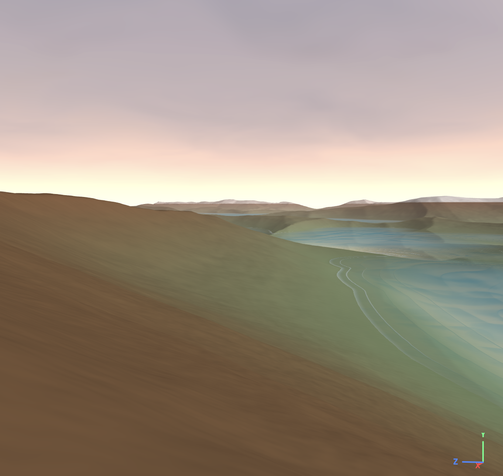
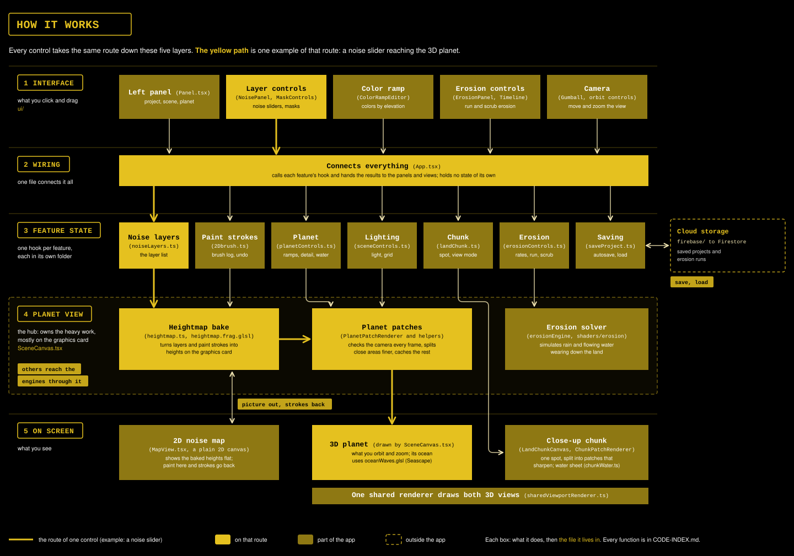
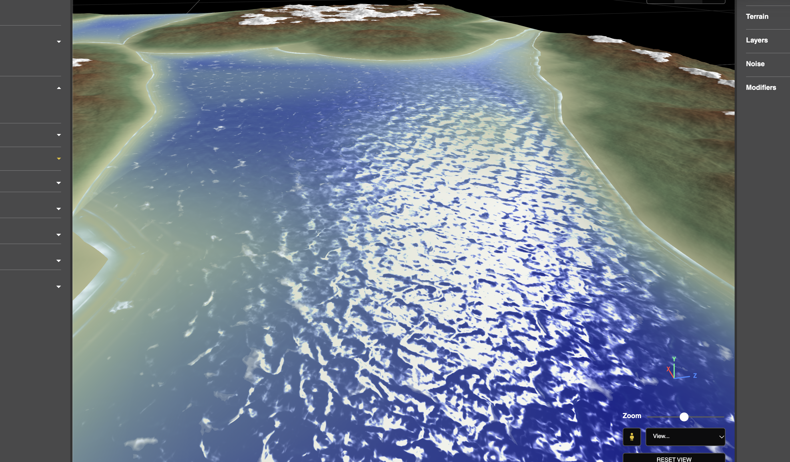
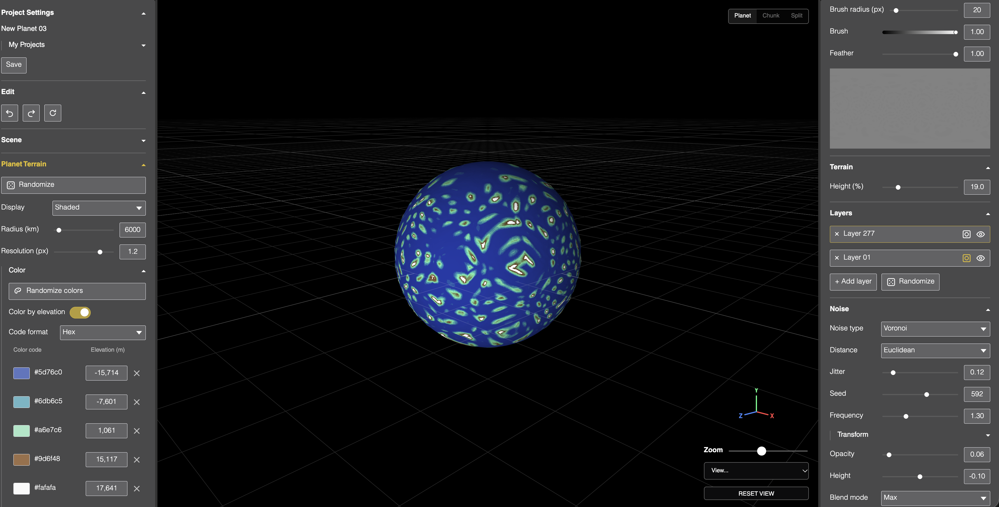
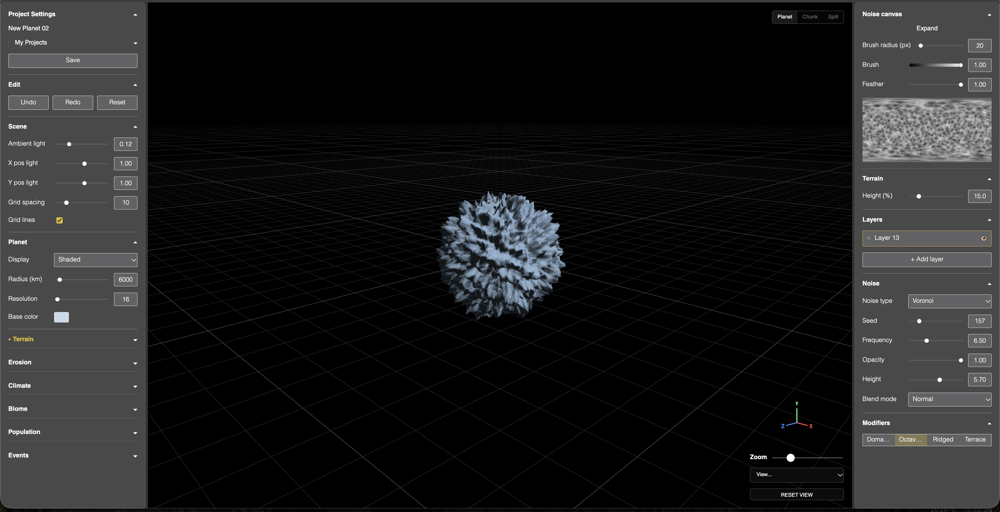
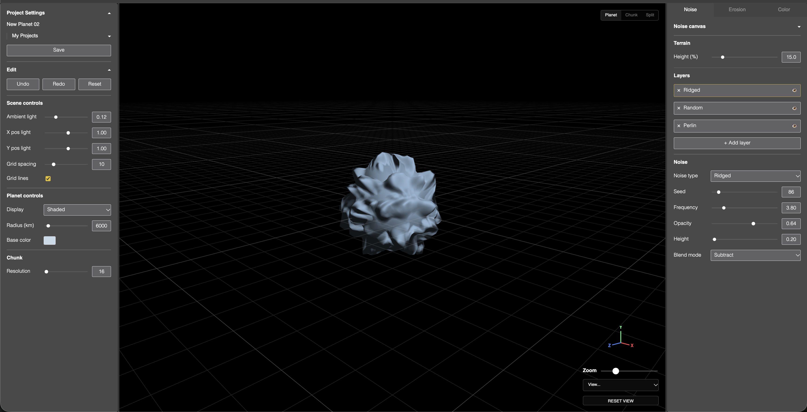
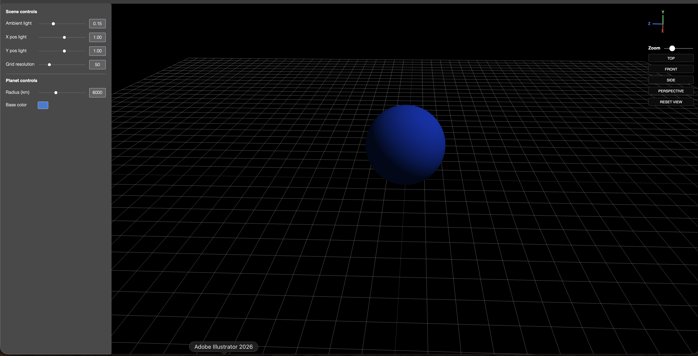

# 📅 Weekly Pushes

`Last updated: 2026-10-28`

*The syllabus's graded weekly report: what was attempted, how AI tools were used, what worked and what comes next. Newest first. Original screenshots live in the course folder `Cornell/Fall 26/PWB/Screenshots/`, outside the repo.*

> [!NOTE]
> **How the entries are numbered.** By the syllabus's own sessions (`Syllabus-FA26-DESIGN6197-SEM130-DRAFT.pdf`, in the course folder): the class meets on Wednesdays, and each weekly report is committed by the start of that Wednesday's class (10:10 am). Work stays in the earlier session's entry until it is committed: the first commit after a class starts the next session's entry. Two entries in one session are marked "part 1 of 2". Sessions 1 and 2 (Aug 26, Sep 2) are left empty, before the project started. The next sessions are pre-built at the end of this file: fill one in, then move it to the top.

---

## Session 11 · Wed 2026-11-04

`Covers 2026-10-28 to 2026-11-04 · Due: start of class, 10:10 am`

*Fixed the regular pattern on the ground up close by giving the land chunk its own high-resolution height map, then rebuilt the moons: up to five, randomized, with tides.*

### 🛠️ Done
- **Ground pattern fixed (`[B66]`, 2026-10-28):** up close the chunk showed stripes and stair-stepped ridges, because its heights were computed as points on the whole 6000 km planet, where floats round to about 0.6 m. The chunk now bakes its own 4096 height map from the planet's noise and resamples it smoothly; finer texture comes from Roughness. Before and after screenshots are in the issue. The water and shadows now read the same map, so the seabed is smooth too.
- **Moons (2026-10-28):** one to five moons in the chunk's sky, each with its own surface baked by the noise engine, two colors, size, place and crescent angle. Randomize sets them all (clearly different sizes, spread across the visible sky, colors that go with the sky, different textures), with a texture-only button and a dropdown for adjusting one moon. Screened over the sky so the shadow dissolves, split-toned (one color for the darks, one for the brights), a soft glow across the edge. A new design-system control, the Dial, sets each crescent's angle.
- **Tides (2026-10-28):** the chunk's water rises and falls every two minutes by the moons' sizes cubed (the tidal-force rule, exaggerated and capped); walk mode pushes the walker to dry ground as it rises.
- **Saving fixed (`[B70]`):** atmosphere changes, Roughness and Auto detail were never autosaved.
- **Concept:** *Everything* (David OReilly) added as an inspiration.
- **Colored shadows (2026-10-28):** the first land shader layer. The flat gray ambient became a sky fill, tinted by the sky's color and a Shadow hue, following Quilez's outdoor lighting rig: No Man's Sky's strong color, softened toward Gris and Sable, with unexpected shading colors set by rule.
- **Walk mode and panel (2026-10-28):** long-press to walk with a Speed slider; the eye no longer sinks into the ground; the planet's flicker while dragging light sliders fixed (`[B72]`); the Scene section grouped into Light, Shadows, Shine, Grid and View.

### 🤖 AI process
- **A day lost to theories:** three fixes were built on unproven causes (octave tweaks, local coordinates for fine detail, smoothing) before Dana's own idea, a dedicated height map resampled at higher resolution, solved it. New working rules: check Dana's proposed mechanism against established tools first, build only on a measured cause, and edit docs only at commit.
- **Measured, finally:** a readout of identical neighboring heights proved the rounding, after a day of guessing.
- **The moon, round after round:** Claude tuned by reacting to each screenshot, so colors went neon, then pale, then neon again, and added changes Dana hadn't approved (a faint dark side, an edge overlap, renamed labels). It also built fixes straight after bug reports without a go. What worked: writing a target spec from the references once, approved by Dana, then building only that. Rule reinforced: change only what was approved, no cleanup or extras.

### 📊 Worked / didn't / next
- ✅ The chunk's own height map, resampled: the established terrain approach.
- ❌ Fixes built on theories: removed.
- ✅ A target spec written from the references, then built in one pass.
- ❌ Tuning by screenshot, and unapproved extras.
- ✅ Measured before fixing: an A/B test and a log proved the flicker's cause in one round.
- ⏭️ The Shadow hue color slider, then slope rock; walk mode's `[B71]` is deferred.

---

## Session 10 · Wed 2026-10-28

`Covers 2026-10-21 to 2026-10-28 · Class topic: Agents and behavior: state machines and schedules · Due: start of class, 10:10 am`

*Made the repo safe to publish and took it public, added an architecture diagram generated from a script, then, after the rubric marked the concept "Fair", turned the project toward story: finished the water, added an atmosphere, and set a 2.5D art direction.*

### 🛠️ Done
- **Publishing:** the Firebase config now comes from environment variables (settings kept in a git-ignored local file, with a template in the repo). Without them the app still loads, with sign-in and saving off.
- **History cleanup:** the whole git history was rewritten twice, so no commit holds the personal email, the Firebase key or the licensed fonts. Every commit now carries the GitHub no-reply address.
- **Public repo:** chosen over adding the professor as a collaborator. Anyone cloning gets the system sans-serif in place of the licensed Helvetica.
- **Docs reorganized:** every doc but the README moved into `docs/`, with screenshots and diagrams in their own folders. The working rules stay local and untracked.
- **Architecture diagram:** generated by a local script, so it is rebuilt from the code's structure instead of hand-drawn, and it stays in step with every structural change.
- **Voronoi Jitter default** lowered from 1 to 0.7, so the slider has room in both directions.
- **Planet detail and zoom (2026-10-26):** the Resolution slider reads 128 to 8192 again and sits in the Scene panel behind an Auto detail toggle; every patch uses one fixed 64-cell mesh, which let close-ups keep splitting; the camera's speed and zoom scale with height above the ground; a planet-wide Roughness adds fractal detail that appears as you zoom.
- **Change of direction (2026-10-26):** the class rubric rated conceptual goals, development and design position "Fair". The story now drives the order: water, atmosphere, planet types (desert, forest, water, volcano, ice), terrain shading, clouds and storms, then evolving alien plants (L-systems, Karl Sims's gene mutation). Infrastructure work pauses. Ian Cheng's *Emissaries* is the anchor reference.
- **Water (2026-10-26):** a sea level shared by planet and chunk with a live "% land" readout; a depth color ramp with the land's ramp editor, split from the land ramp at sea level (the cartographic convention); Seascape's waves on both views, band-limited with distance, with crest foam, currents and waves breaking on the shore. Still being tuned.
- **Interface (2026-10-26):** menus start closed except Project and Edit; Color holds Land and Water parts; Space and drag pans the land chunk (Figma's convention); a click in walk mode walks at most 100 m and can be stopped.
- **Performance (2026-10-26):** the planet's height statistics moved onto the GPU histogram and an asynchronous read the chunk already used, removing a 250 ms freeze on every slider tick; per-frame work now copies only the camera position.

- **Water finished (2026-10-27):** a Water menu section; Shine and Reflection; wind sets wave length, height and speed (Pierson-Moskowitz and the deep-water dispersion relation), whitecaps and storm streaks by the Beaufort scale, and the glint's width (Cox and Munk); large Gerstner waves add moving light and dark variance; surf only where waves break (McCowan's criterion); seams at the planet's cube edges removed by triplanar mapping; planet frame rate up from about 20 to about 80 by skipping wave work that can't be seen.
- **Atmosphere (2026-10-27, replacing the Climate stage):** a sky dome over the land chunk (three.js's own example), haze, a rim glow and surface haze on the planet, and clouds with Horizon Zero Dawn's cloud lighting and edge erosion, NASA's cloud bands and NOAA's wind bands. General controls on the left, Wind, Clouds and Moon on the right panel.
- **Lighting fixed at the root (2026-10-27):** the land was lit in camera space and its planet normals pointed inward, hidden by a light setting that compensated. Both fixed in the shared shader code; a "Light follows camera" toggle (on by default) lights whatever is in view.
- **Art direction (2026-10-27):** 2.5D, real 3D but flatter, between No Man's Sky and Sable; reference images from No Man's Sky, Sable, Outer Wilds and Gris added to the repo. Shaders reorganized into folders by feature.
- **Land chunk detail (2026-10-26):** the chunk now splits into patches as you zoom, the planet's chunked level-of-detail rule over a flat square, so close-ups keep gaining shape. Patch textures carry a border of neighbor ground so lighting matches across edges. The chunk camera orbits and zooms around the ground under the cursor and stays above the terrain, Cesium's convention. Voxel style is being dropped.

### 🤖 AI process
- Rewrote history with care for what GitHub keeps: old commits may stay reachable by ID for a while, so the leaked key still needs restricting or regenerating at the source.
- The permission check blocked Claude from force-pushing, so Dana ran the force-pushes herself. That kept the irreversible step in her hands.
- The diagram's visual language was inferred from Dana's own reference diagrams, not from the app's design system, which governs the UI only.
- **Measured before fixing:** a first fix for close-up detail was a theory and made it worse. A temporary on-screen probe then showed the real limit (the mesh tiers exhausting the triangle budget), and the fix followed from that.
- **Two more slips (2026-10-26):** an unsourced slope method was bundled into an approved plan, then removed when no source turned up; and a claim about what a slider fed was stated without reading the code. Both are now standing rules: no unsourced add-ons, read before claiming.
- **Measured, then fixed (2026-10-26):** timing logs showed the slider lag was a full synchronous GPU readback; the chunk had already solved the same problem two weeks earlier, and the fix was to reuse it. A rule now requires checking past performance fixes first.
- **Debug views before guessing:** a temporary view that drew one ingredient of the water color at a time found two real bugs (an unlit water normal, a seabed that never faded), after two confident guesses had been wrong.
- **Copy tested work first:** a hand-built water shader went through several weak rounds before switching to a known shader (TDM's Seascape). The lesson is now a standing rule. Sources are verified by reading them, and when only a summary was read the docs say so; one article was pasted by Dana because the site blocks automated readers.
- **Research agents:** two research agents and several page-reading helpers were used, each reported with its token cost (about 7k to 63k each).
- **An unasked rewrite (2026-10-27):** asked to add wind and glint changes to the water, Claude replaced the whole tested water shader with a hand-written one. It broke the planet, looked worse and was reverted, at a large token cost. New standing rule: never replace a working system unless asked; layer onto it.
- **Root fixes over workarounds (2026-10-27):** a light setting of −4.3 had silently compensated for inward-facing normals. Fixing the space mismatch exposed it; the fix went into the shared normal function (`faceforward`), not another compensating value.
- **Sources read, not recalled:** the cloud formulas were read from the Horizon Zero Dawn slides themselves after a summary came back empty; claims recalled from memory were flagged as such.
- **A slip:** the README screenshot's alt text was written from the filename without looking at the image. It was checked against the image and corrected afterward.

### 📊 Worked / didn't / next
- ✅ Keeping secrets out of the code with environment variables and a template file, the standard approach for client config.
- ❌ The key had already been committed, so cleaning history alone does not undo the exposure.
- ✅ Reusing the chunk's GPU statistics for the planet: slider lag gone.
- ❌ Hand-built water, three rounds; the shader that works was copied, not invented.
- ✅ Layering the research onto the tested water shader instead of replacing it.
- ❌ Replacing Seascape with hand-written waves: reverted the same day.
- ⏭️ Test and tune the atmosphere, Swirl as Musgrave's Coriolis twist, rain or snow, then terrain shading in the 2.5D direction, then planet profiles.

---

## Session 9 · Wed 2026-10-21

*Unified the planet and chunk under one renderer, chased the chunk's color and shadow bugs to their real causes, then rebuilt how the planet picks its detail and how terrain noise is made. The week ran Monday 2026-10-19 to 2026-10-21 so far.*

> [!NOTE]
> Screenshots are kept in the course folder, `Cornell/Fall 26/PWB/Screenshots/`, outside this repo. The copies in `docs/screenshots/` here are the ones the docs link to.

### 🛠️ Done
- One shared `WebGLRenderer`/canvas for both viewports (planet and chunk), replacing two independent ones, the base that lets a baked patch texture hand off straight to the GPU with no CPU readback.
- Both the planet and the chunk now render as terrain patches (a quadtree, each with its own baked heightmap) instead of one mesh sampling a shared map. Planet side was gated behind a flag at first, pending a render/freeze regression that did not reproduce when tested (2026-10-20).
- Land chunk: the material is built once and reused instead of rebuilt on every Resolution change (fixed a flash-to-flat flicker while dragging), resolution changes are debounced, and the texture ceiling was raised to the real WebGL2 floor (2048).
- Land chunk shading: the top surface and the cut walls/bottom cap now get two separate, non-bleeding elevation sources for color, lighting, and shadow, via a new per-triangle flag, fixing a hard seam that only showed up at certain light angles.
- Widened the normal-reconstruction gradient step, removing harsh, faceted-looking lighting on dense terrain.
- The elevation color ramp now reads the planet's own global range rather than computing one per patch, a whole-dataset color stretch, the standard GIS convention for this.
- Hydraulic erosion simulation (grid-based, GPU), with checkpointing and a scrub timeline.
- Real SVG icons replacing emoji button glyphs.
- **2026-10-20/21, the planet's patches:** seams between patches fixed at their cause (a half-texel edge offset, then different vertex counts across a detail boundary), then cross-face stitching, a patch cache so hidden patches are not rebuilt, and detail chosen by on-screen error in pixels (the 3D Tiles and Cesium convention) with the Resolution slider as a pixel threshold.
- **Color ramp:** a multi-stop gradient editor where every stop, including the base color, is equal and movable; elevations shown and editable in meters; planet and chunk share one lighting model with a shared normal function.
- **Terrain noise:** per-layer masks with their own pattern (Coverage, Softness, Invert, Shuffle), a better hash, octaves that fade out when finer than the grid, new controls (offset, stretch, warp scale, Voronoi jitter and distance, ridge offset and gain), fractal types (multifractal, hybrid, hetero, ridged) and extra octaves at deeper patches, all with ranges from one table so Randomize never hardcodes a range.
- **Interface:** Planet and Terrain merged into one panel, icon buttons, black wrapped tooltips, a reusable popup, and a `CODE-INDEX.md` so reads can be narrow.

### 🤖 AI process
- **2026-10-21:** blamed a stale browser tab for a missing base-color row that was a real bug; parked a requested zoom-detail feature as optional; built a uniform minimum Resolution that contradicted how the user expected zoom to work. Each was corrected, the last by confirming screen-space error against the Cesium and 3D Tiles docs.
- Held methods to sourced documentation: Gaea, Blender's Musgrave source, Quilez, Cesium, a peer-reviewed hash paper. Anything unsourced was flagged and left tunable.
- **A cost failure:** about 30 forked agents, 250,000 to 600,000 tokens each and many for small doc edits, used up the session limit. New binding rules: no forks, agents only with approval and a cost estimate, docs edited directly, narrow reads through the code index.
- Traced a wall-coloring "bleed" to its exact mechanism twice over: first an interpolating vertex attribute used as a material switch, then the same mistake found again in a second code block (normals, shadows) missed the first time.
- Corrected twice: once for treating a real, undecided design tradeoff as already settled, once for floating a dev-tooling explanation (stale hot-reload) ahead of the actual code-level bug.
- Checked a claim about dev-tooling behavior (Vite's hot reload, React's Fast Refresh) against real documentation before relying on it, then dropped it once a concrete, provable code cause was found instead.

### 📊 Worked / didn't / next
- ✅ Tracing a visual bug to the exact line and explaining the mechanism, instead of proposing a fix from a plausible-sounding theory.
- ❌ Two earlier wall-color fixes each solved the stated complaint but reintroduced a seam somewhere else. The durable fix needed a true non-interpolated flag, not a branch on an attribute already doing another job.
- ✅ Checking a method against its source before building it, which caught a wrong channel read in the planet's lighting and a hash that bands.
- ❌ Forking agents that inherit the whole conversation. It was the most expensive mistake of the week.
- ⏭️ Dana tests the batch, then the second fade pass for ridged, terrace, warp and Voronoi, bounded heights, plateaus, height in meters, undo/redo, and planet shadows.

---

## Session 8 · Wed 2026-10-14

*Rebuilt the planet on a cube sphere, and made the chunk a real piece of it.*

### 🛠️ Done
- Replaced the planet's longitude/latitude sphere with a cube sphere. A lat/long grid converges at two fixed points and cannot be subdivided locally, so it cannot support detail that follows the camera.
- Fixed the two seam bugs that switch exposed: a black slit, from lighting rebuilding its surface direction out of map coordinates, and terrain tearing at both poles, where the map's wrap line crosses the pole faces.
- Introduced the patch: one piece of the planet's surface with its own heightmap. Everything showing terrain now consumes patches.
- Rebuilt the land chunk as a patch drawn flat. Its Resolution reaches real detail instead of enlarging a window of a shared map, and double-clicking the planet picks which piece it shows.
- Moved the chunk onto the planet's lighting model, so the Scene controls mean the same thing in both views.
- Restructured the docs: split `SPEC.md` out of `ISSUES.md`, added `REFERENCES.md`, and cut both main docs by roughly two thirds.

### 🤖 AI process
- A wrong diagnosis cost most of the session. The claim was that reading height from the rectangular map is lossy at the poles; it is the reverse. A pipeline rebuild was built on it and reverted.
- What eventually found the real cause was rendering the data to screen rather than reasoning about it. Colouring the six faces ruled out a broken mesh; drawing height as greyscale showed exactly where it jumped.
- Two failures worth recording: a GPU texture-limit warning sat unread in the dev log throughout, and "the shader compiled" was treated as proof an approach worked when the failure was at bind time.

### 📊 Worked / didn't / next
- ✅ Building a diagnostic view instead of arguing further. Each one ruled out a whole class of cause in one screenshot.
- ✅ Checking conventions before committing to an architecture. Cesium's tile model and Outerra's per-patch heightmaps shaped the patch directly.
- ❌ Reasoning from first principles. It produced a confident wrong diagnosis and several fixes aimed at the wrong layer.
- ❌ Proposing small fixes already known to need replacing. Corrected toward building the durable unit once.
- ⏭️ Erosion as a reusable engine, plus the Timeline. Research points to grid-based rather than the droplet approach logged in September, since droplets need scattered writes that WebGL handles badly.

---

## Session 7 · Wed 2026-10-07

*Answered the procedural-system feedback with a pipeline, not a UI tweak.*

### 🛠️ Done
- Responded to class feedback that the project reads as 3D terrain software rather than a procedural system, by researching real tools rather than reacting with a UI tweak.
- Decided the pipeline and its stages: Terrain, Erosion, Climate, Biome, Color, Population, Events. Colour became its own shader-driven stage; Population and Events are new.
- Decided Erosion is built as one reusable engine, so disasters become parameter values rather than separate effects.
- Decided the chunk moves onto the planet's shader, so shadows get implemented once for both rather than per view.
- Planned the left panel as the pipeline menu, with the right panel showing the selected stage.

### 🤖 AI process
- Cited real sources for every naming and ordering decision rather than asserting a preference.
- Corrected twice on pushback: proposed the easier shadow path, and misplaced general settings inside a stage.
- Flagged one citation as unverified rather than presenting it as sourced.

### 📊 Worked / didn't / next
- ✅ Searching conventions before deciding. It overturned one instinct and confirmed another.
- ⚠️ Defaulted to the lower-effort path twice, corrected directly rather than caught by testing.
- ⏭️ Build the pipeline menu; unify the chunk's shading; begin erosion.

---

## Session 6 · Wed 2026-09-30 · part 2 of 2

*Separated height from opacity, and made the modifiers composable.*

### 🛠️ Done
- Split terrain Height from the opacity composite into its own additive elevation channel, after the first pass turned out mathematically indistinguishable from Opacity.
- Fixed Ridged noise not being zero-mean, which inflated the whole planet once Height went unclamped.
- Made Height a percentage of its context, so one value reads proportionally on both the planet and the chunk.
- Made both panels user-resizable, and fixed the 2D canvas being a fixed-size square.
- Restructured noise modifiers from mutually exclusive types into composable toggles on any base generator, matching Gaea's structure.
- Received the class feedback on procedurality, and began a structured response rather than a cosmetic pass.

### 🤖 AI process
- Implemented before an explicit go-ahead again, caught and logged.
- Worked out the Height/Opacity collapse mathematically before proposing a fix rather than patching the symptom.
- Misdiagnosed a UI complaint once, then asked a precise question instead of guessing again.

### 📊 Worked / didn't / next
- ✅ Doing the elevation maths explicitly. The first instinct looked reasonable until tested.
- ⚠️ Three things needed a second full pass: the Height split, the panel width, and the Modifiers UI.
- ⏭️ Work through the procedural-system feedback properly.

---

## Session 6 · Wed 2026-09-30 · part 1 of 2

*Found the real resolution ceiling and rearchitected around it.*

### 🛠️ Done
- Rearchitected voxel meshing from a 3D grid to a column-based one, which was the real ceiling blocking the Resolution slider, and raised its maximum from 64 to 2048 as a result.
- Replaced four hand-derived wall cases with one boundary rule.
- Added layer multi-select with batch edit, visible drag-to-reorder, and a per-layer visibility toggle that genuinely skips a hidden layer's computation.

### 🤖 AI process
- Verified the new meshing's winding by hand via cross product rather than guessing.
- Added explicit checks for the new visibility field so older saved layers default to visible.

### 📊 Worked / didn't / next
- ✅ Tracing the Resolution ceiling to its real cause rather than raising the slider's maximum again, which had been tried first.
- ⏭️ Per-layer Height, contextual Resolution, shadows for the chunk.

---

## Session 5 · Wed 2026-09-23 · part 2 of 2

*Built the land chunk and the side-by-side view.*

### 🛠️ Done
- Added Redo, and reworked project naming so a project is never in an unnamed state.
- Built Stage 07: a side-by-side planet and chunk view with a resizable split and a mode control.
- Two render styles for the chunk from the same data: blocky voxel meshing in a Worker, and a smooth displaced surface extruded into a grounded slab.
- One shared gumball driving one or two cameras, each with its own reference distance.
- Fixed panes being destroyed on every view-mode switch, which reset the camera and the planet's colour.

### 🤖 AI process
- Corrected twice for implementing before a go-ahead, logged both times.
- Hand-verified the mesh winding rather than copying it, since it is derivable rather than a citable algorithm.

### 📊 Worked / didn't / next
- ✅ Designing the gumball around a list of targets from the start, once two instances was clearly wrong.
- ⚠️ Its zoom maths assumed the planet's scale and needed a second pass for the much smaller chunk.
- ⏭️ The voxel resolution ceiling; layer multi-select.

---

## Session 5 · Wed 2026-09-23 · part 1 of 2

*Real persistence, and two compositing bugs that needed the maths.*

### 🛠️ Done
- Set up real persistence: Firebase Auth and Firestore, anonymous sign-in, deployed security rules, and the layer stack saving per user.
- Fixed a compositing bug where adding a layer appeared to erase painted terrain beneath it. Took two attempts.
- Fixed brush strokes cutting off at the seam instead of wrapping.
- Rewrote stroke rendering as a distance to the whole stroke path, replacing a per-dab approach that left a visible crease.
- Restructured `ROADMAP.md` and `ISSUES.md` to Dana's design direction.

### 🤖 AI process
- Slipped once more on confirm-before-acting, caught and logged.
- Walked Dana through the Firebase console and CLI steps only she could do.
- Diagnosed two rendering bugs from screenshots via the actual maths rather than guessing.

### 📊 Worked / didn't / next
- ✅ Screenshots and live testing surfaced two subtle maths bugs that reading the shader would not have.
- ⚠️ The layer-erasing fix took two real attempts; the first applied the same mask twice.
- ⏭️ Erosion; revisit the still-jagged painted terrain.

---

## Session 4 · Wed 2026-09-16

*The layer stack, the brush, and lighting that finally showed relief.*

### 🛠️ Done
- Built the multi-layer noise system: a Photoshop-style stack up to 16 layers, each with its own type, parameters, opacity and blend mode.
- Built the paint brush on the 2D heightmap, with strength and feather, live on both the preview and the planet.
- Fixed the planet having no real per-pixel normal, so terrain bumps did not show in lighting at all.
- Fixed paint erase doing nothing, diluted partial-opacity strokes, a pole tear, a faceting regression, and a brush-radius unit bug.
- Iterated the feather model through four designs based on live testing.

### 🤖 AI process
- Slipped twice on confirm-before-acting, logged each time.
- Verified rather than assumed: GPU float-blending support, Gaea's blend-mode formulas, and the normal's winding by hand.

### 📊 Worked / didn't / next
- ✅ Testing live and iterating from what was on screen. Several bugs only made sense once rendered.
- ⚠️ The feather design took four attempts, because the intent needed pinning down before implementing rather than after.
- ⏭️ The stroke-opacity fix; rebuild Expand; restructure modifiers; erosion.

---

## Session 3 · Wed 2026-09-09

*Scaffolded the project and the base scene.*

### 🛠️ Done
- Scaffolded the project with Vite, React, TypeScript and Three.js.
- Built the base scene, the planet with its own GLSL shader, the UI component set, the left control panel, and ported the gumball widget.
- Set up the documentation structure, each file with a distinct scope.

### 🤖 AI process
- Strict confirm-before-acting from the start.
- Ported real code and values from `active-geometry-project` rather than inventing conventions, and debugged a StrictMode leak, an off-centre view, and a `pointer-events` cascade.

### 📊 Worked / didn't / next
- ✅ Going back to the actual source rather than memory. Once real font files and exact values were used, the UI matched.
- ⚠️ Several first passes drifted from the source without being flagged, caught by side-by-side comparison rather than by memory.
- ⏭️ Colour-picker decision, terrain generation, design-system tokenization.

---

## Session 2 · Wed 2026-09-02

`Covers 2026-08-26 to 2026-09-02 · Class topic: AI tools tutorial, context engineering, React and Three.js · Due: start of class, 10:10 am`

*No project work recorded this session.*

### 🛠️ Done

### 🤖 AI process

### 📊 Worked / didn't / next

---

## Session 1 · Wed 2026-08-26

`Covers up to 2026-08-26 · Class topic: Intro to the syllabus and lecture · Due: start of class, 10:10 am`

*No project work recorded this session.*

### 🛠️ Done

### 🤖 AI process

### 📊 Worked / didn't / next

---

## 🗓️ Pre-built sessions

*Skeletons for the rest of the semester. Fill one in, rename nothing, then move it above Session 9. The final deliverable is due Dec 18 and is a separate package, not a weekly entry.*

### Session 11 · Wed 2026-11-04

`Covers 2026-10-28 to 2026-11-04 · Class topic: Procedural cultures · Due: start of class, 10:10 am`

*⚪ One-line summary of the week.*

🖼️ ``

#### 🛠️ Done
- ⚪

#### 🤖 AI process
- ⚪

#### 📊 Worked / didn't / next
- ✅
- ❌
- ⏭️

### Session 12 · Wed 2026-11-11

`Covers 2026-11-04 to 2026-11-11 · Class topic: Optimization and performance · Due: start of class, 10:10 am`

*⚪ One-line summary of the week.*

🖼️ ``

#### 🛠️ Done
- ⚪

#### 🤖 AI process
- ⚪

#### 📊 Worked / didn't / next
- ✅
- ❌
- ⏭️

### Session 13 · Wed 2026-11-18

`Covers 2026-11-11 to 2026-11-18 · Class topic: Optimization and performance · Due: start of class, 10:10 am`

*⚪ One-line summary of the week.*

🖼️ ``

#### 🛠️ Done
- ⚪

#### 🤖 AI process
- ⚪

#### 📊 Worked / didn't / next
- ✅
- ❌
- ⏭️

### Session 14 · Wed 2026-12-02

`Covers 2026-11-18 to 2026-12-02 · Class topic: Final review (no class on Nov 25, Thanksgiving break) · Due: start of class, 10:10 am`

*⚪ One-line summary of the week.*

🖼️ ``

#### 🛠️ Done
- ⚪

#### 🤖 AI process
- ⚪

#### 📊 Worked / didn't / next
- ✅
- ❌
- ⏭️
